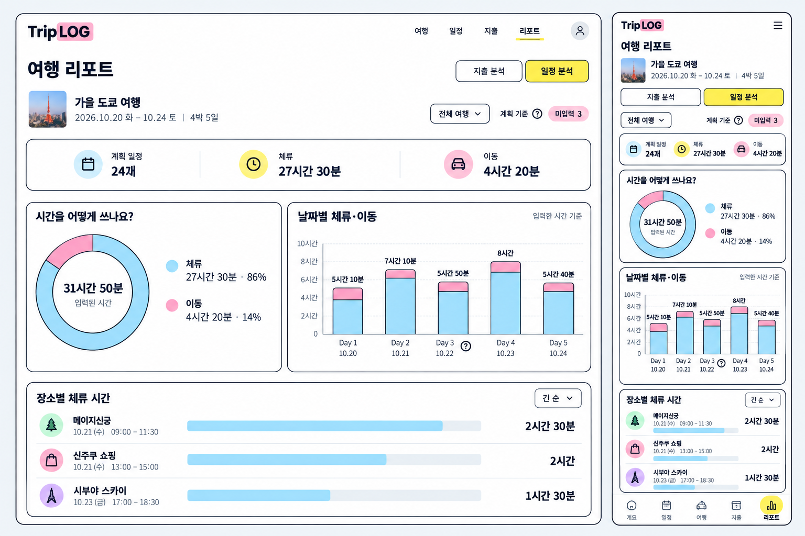

# 지출 분석의 디자인 톤을 적용한 일정 분석 목업

2026-11-02 이미지 목업 제작. 2026-11-03 사용자 승인·구현 요청에 따라 로컬 구현 완료. 운영 여행 데이터와 배포는 변경하지 않았다.

## 요청과 구성

사용자는 리포트의 일정 분석이 현재 앱의 디자인 톤과 맞지 않는다고 지적하고, 지출 분석의 디자인을 지키면서 시각화가 쉽게 읽히는 개선 목업을 요청했다. 기존 일정 분석의 여행 도구 계열 스타일에서 지출 리포트의 흰 배경·남색 테두리·노란 선택 표시·파스텔 차트와 공통 글자 체계로 정리하는 방향이다.

- 공통 여행 리포트 헤더·여행 정보·지출/일정 분석 탭·날짜 선택을 사용한다. 구현 시 실제 공통 여행 컨텍스트·메뉴·브랜드 자산을 재사용한다.
- 일정 수·입력된 체류·기록된 이동은 간결한 요약 한 줄로 표현한다.
- 체류/이동 합계에서 산출할 수 있는 시간 비중을 지출 분석과 같은 도넛·범례 형식으로 제시한다. 체류는 파랑, 이동은 분홍으로 모든 차트에서 같은 의미를 유지한다.
- 날짜별 시간은 지출 추이와 같은 세로 막대의 체류/이동 누적으로 표현하고 총 시간을 막대 위에 표시한다.
- 장소별 체류는 기존 정렬 기능과 연결할 수 있는 카테고리 아이콘·비례 막대·우측 시간을 사용한다. 장소마다 별도 삽화를 만드는 방식이 아니다.
- 미입력 항목 수는 작은 상태 표시로 보존하며 미입력 시간을 임의의 시간으로 환산하지 않는다.
- PC는 도넛과 날짜별 막대를 나란히, 장소별 목록을 아래에 놓는다. 모바일은 같은 시각화를 세로로 배치한다.

현재 모델은 일정 수·체류 합계·이동 합계·날짜별 합계·장소별 체류·미입력 목록을 제공한다. 도넛의 비중은 해당 합계에서 계산 가능한 추가 시각화 제안이며 앱 기능을 변경한 것은 아니다. 시간은 입력된 계획 시간의 합계이며 실제 경과 시간이나 GPS 이동 시간을 의미하지 않는다. 기존처럼 숙소·교통 테마 제외 및 겹친 일정의 합산 기준은 구현 때 유지·표시해야 한다.

## 생성과 보존

- image-creator 스킬, 내장 `image_gen`, 이미지 입력 없는 T2I 1회.
- PC 1280 CSS px / 모바일 390 CSS px를 목표로 한 이미지 목업이다. 실제 브라우저 렌더 검증 결과는 아니다.
- [도구에 전달한 최종 영문 프롬프트](prompt.txt), [정확한 생성 원본 경로·시각·SHA256·예시 수치](generation.json).
- 도구가 반환한 정확한 원본 PNG를 단일 파일 생성 폴더로 복사하고 저장 도우미를 사용했다. 호출 원본과 최종 저장본의 SHA256 일치를 확인했다. 기존 파일을 덮어쓰지 않았고 원래 생성 파일도 보존했다.
- 여행명·수치·날짜는 합성 예시다. 체류 1,650분 + 이동 260분 = 1,910분(31시간 50분)이며 날짜별 합계도 동일하다.

2026-11-03 사용자는 상단 요약을 지출 분석과 같은 공통 컴포넌트로 사용하고, 계획 일정·체류·이동을 분석 버튼 위에 배치하도록 목업의 위치를 수정했다. 두 탭은 같은 요약 영역과 버튼 DOM을 유지하며, CSS 그리드로 두 요약 중 큰 쪽의 자연 높이를 공유해 탭 위치를 보존한다. 실제 여행 컨텍스트·소분류 아이콘·입력/정렬 컨트롤을 재사용했고 예시 사진이나 수치를 앱에 넣지 않았다. [구현·검증 기록](../../qa/20261103-report-unified/README.md).
