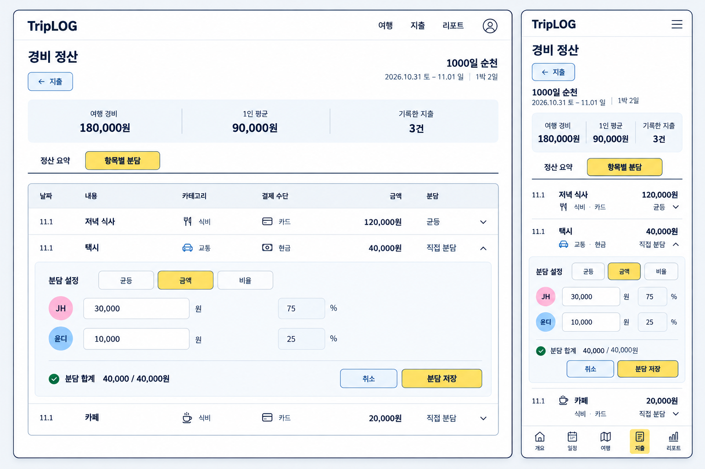

# 지출 표 기반 항목별 분담 편집 — 구현 전 목업

2026-11-02 · 사용자 요청: 기존 지출 기록 표를 공통 컴포넌트로 재사용하고 분담액/비율만 편집할 수 있도록 개선. 새 표 기반 편집 배치는 먼저 목업을 확인하기로 사용자가 선택했다. 이후 사용자가 “ㅇㅇ 구현ㄱㄱ”로 이 행 펼침 방식을 승인했다. [구현·검증 기록](../../qa/20261102-settlement-inline/README.md)에 실제 화면과 테스트 결과를 보존한다.

## 확인할 흐름

1. 기존 지출 기록 표의 날짜·내용·카테고리·결제 수단·금액을 그대로 표시한다.
2. 우측 분담 버튼을 누르면 해당 행 바로 아래가 펼쳐진다. 모바일도 같은 행 아래에 분담 입력이 열린다.
3. 기존 균등/금액/비율 컴포넌트를 재사용한다. 금액 모드에서는 분담액을 입력하고 비율을 계산해 표시하며, 비율 모드에서는 비율을 입력하고 분담액을 계산한다.
4. 변경 대상은 분담 설정이며 원래 지출 금액·내용·날짜·결제자는 바꾸지 않는다. 기존 `settlement.itemSplits[current:<entryId>]`에 같은 형식으로 저장한다.
5. 취소하면 원래 분담을 유지하고, 분담 저장이 성공하면 접힌 행/정산 요약에 반영한다. 불완전한 합계·동행 변경·다른 곳의 변경은 기존 분담 편집기와 같은 규칙으로 처리한다.

이미지는 표와 행 펼침 동작을 검토하기 위한 목업이다. 구현할 때 실제 공통 로고·여행 정보·경비 요약·하단 메뉴를 그대로 재사용한다.

## 생성 기록

- image-creator 스킬, 내장 image_gen, 이미지 입력 없는 T2I 1회.
- [최종 영문 프롬프트](prompt.txt), [정확한 호출 원본 경로·시각·SHA256](generation.json).
- 도구가 반환한 정확한 PNG를 작업 폴더의 한 파일만 있는 생성 폴더로 복사한 뒤 저장 도우미로 저장했고, 호출 원본과 최종 보존본의 SHA256 일치를 확인했다.
- 기존 파일을 덮어쓰지 않았다. 생성 원본은 원래 경로에 보존한다.
