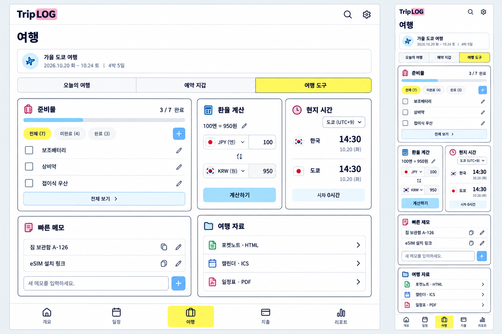
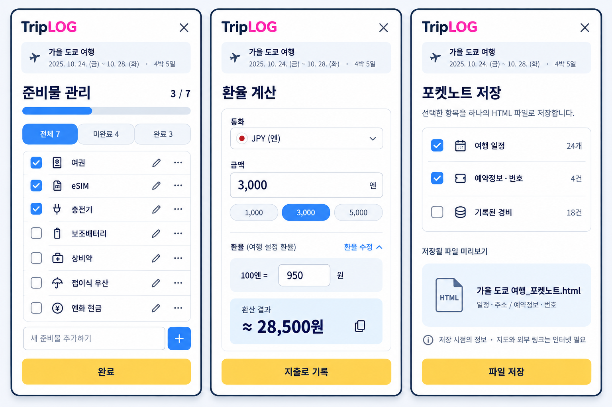

# 여행 도구 — 공통 컴포넌트와 실제 사용 흐름 중심 목업

2026-11-02 · 사용자 검토용 이미지 목업. 앱 소스·실행 자산·운영 여행 데이터·배포를 변경하지 않았다. 사용자는 공통 컴포넌트와 현재 디자인 톤을 지키면서 여행 도구의 사용성을 보강하는 목업을 요청했다.

## 메인과 상세

두 이미지는 같은 개편안의 메인과 상세이며 대안 디자인이 아니다. 목표는 PC 1280 CSS px / 모바일 390 CSS px와 상세 390 CSS px 세 화면이다. 목표 크기는 실제 브라우저 검증 결과를 뜻하지 않는다.

## 기능과 정보 우선순위

| 영역 | 현재 기능과 관계 | 제안하는 역할 |
| --- | --- | --- |
| 준비물 | 체크·추가·수정·삭제·남은 항목·진행 수치가 있음 | 메인에는 남은 항목을 짧게, 관리 화면에는 전체/미완료/완료와 인라인 추가·수정 |
| 환율 계산 | 지출 편집기의 통화·금액·환율·원화 환산 표현과 검증을 사용할 수 있음 | 여행 설정 환율로 계산하고 결과 복사 또는 지출 추가 폼으로 전달 |
| 현지 시간 | 기존 여행 시간대 선택은 오늘 날짜·ICS 기준으로 사용 중 | 한국/현지 시각과 시차를 보여주고 같은 시간대 설정으로 연결 |
| 빠른 메모 | 이번 목업의 추가 제안 | 보관함 번호·eSIM 링크 같은 짧은 여행별 텍스트 추가·복사·수정 |
| 여행 자료 | 포켓노트 HTML·ICS 저장, 기존 일정 PDF 기능이 있음 | 같은 목록형 컴포넌트로 세 파일 저장 진입점을 모음 |

환율 계산기는 실시간 시세 서비스가 아니다. 합성 예시는 여행 설정 환율 `100엔 = 950원`으로 `3,000엔 = 28,500원`이다. 환율 수정은 계산용 입력이며 기존 지출 금액이나 여행 전체 환율을 임의로 다시 쓰지 않는다. ‘지출로 기록’은 기존 입력창에 금액·통화·적용 환율을 채우는 연결이며 사용자가 저장하기 전 지출을 생성하지 않는다.

현지 시각 14:30은 합성 예시이며 실제 시각 조회 결과가 아니다. 시간대는 기존 일정·캘린더 기준과 일치시켜야 한다. 국내 여행에서 환율/시차 영역을 어떻게 줄일지는 구현 전 별도로 확인할 상태다.

준비물 예시는 여권/eSIM/충전기 완료, 보조배터리/상비약/접이식 우산/엔화 현금 미완료로 3/7이다. 메인은 남은 4개 중 일부를 보여주고 전체 관리로 연결한다. 체크마다 별도 저장 버튼을 요구하지 않는다.

포켓노트는 선택한 정보를 내려받는 HTML 파일이다. 체크 예시는 일정 24개와 예약정보 4건 포함, 지출 18건 제외다. 파일 크기를 미리 꾸며 표시하지 않는다. 지도·외부 링크에는 인터넷이 필요할 수 있고 캘린더는 ICS 파일을 가져오는 방식이며 계정 자동 동기화가 아니다. PDF는 기존 일정 출력 경로의 바로가기다.

## 공통 컴포넌트 계약

| 요소 | 재사용할 현재 소스 / 스타일 |
| --- | --- |
| 브랜드·여행 정보 | 기존 앱 헤더와 `src/app/ui/trip-context.js` |
| 여행 내 탭·하단 메뉴 | 기존 여행 탭, `src/app/navigation/trip-navigation.js`, `src/assets/navigation/`의 동일 크기 아이콘 |
| 보조·주요 버튼 | `ui.markup.expenseAction`, `.ex-button.ex-secondary`, `.ex-button.ex-primary`의 파랑/노랑·테두리·모서리·그림자 |
| 입력·선택 | 기존 `ui/form-controls.js`, `ui/custom-select.js`, 지출 통화/금액/환율 필드의 표현과 검증 |
| 준비물 체크·저장 | `features/packing/packing-list.js`, 기존 체크 목록·인라인 필드, 공통 도메인 명령 |
| 관리·계산·파일 저장 창 | `src/app/ui/dialog.js`의 로고·닫기·본문·하단 동작 구조 |
| 자료 목록 | 공통 설정 목록 행, 작은 아이콘·형식 표시·우측 펼침 표시 |
| 작은 그림 | 프로젝트 공통 컬러 아이콘·Phosphor 계열. 장소별 전용 스티커를 만드는 구조가 아님 |

흰 바탕, 노란 주요 동작/선택, 파란 보조 동작, 분홍 보조 표시를 기준으로 한다. 아이콘에 내부 사각형 테두리를 덧씌우지 않는다. 제목 20px/600, 섹션 15px/600, 본문 13–14px, 보조 12px, 입력 16px가 목표다. 실제 구현은 위 공통 소스와 컴포넌트 계약을 기준으로 하며 생성 이미지의 임의 날짜·브랜드 그림·아이콘·제어 색을 별도 UI로 복제하지 않는다.

일부 기능은 재사용할 시각 스타일과 도메인 API를 갖고 있다는 뜻이며 모두 독립 UI 팩터리로 이미 분리됐다는 뜻은 아니다. 구현 시 필요한 공통화는 기존 흐름을 유지하는 범위로 계획한다. 큰 표지·설명 문장·예약/지출 대시보드 반복·사진 업로드·주변검색·날씨는 추가하지 않는다.

## 생성과 검토 범위

image-creator 스킬과 내장 image_gen을 사용한 T2I 2회이며 이미지 입력은 없다. 이전 목업을 이미지 입력으로 재사용하지 않았다. 최종 영문 프롬프트는 [메인](main-prompt.txt), [상세](detail-prompt.txt), 정확한 도구 반환 원본 경로·시각·보존본 SHA256은 [generation.json](generation.json)에 기록했다. 각 호출의 정확한 원본을 서로 다른 단일 파일 폴더로 복사한 뒤 저장 도우미를 사용했고 최종본과 SHA256 일치를 확인했다. 기존 파일을 덮어쓰지 않았으며 생성 원본도 보존했다.

구현 승인 전까지 앱 코드에 적용하지 않는다. 메모 저장 범위, 국내 모드, 빈 목록/완료/검증·저장 실패 상태 및 별도 연결 화면에 새 디자인이 필요하면 해당 목업과 방향도 먼저 확인한다. 구현 단계에서는 320/390px·전환점 양쪽·PC에서 실제 글꼴/줄바꿈/높이/터치 영역을 확인한다.
