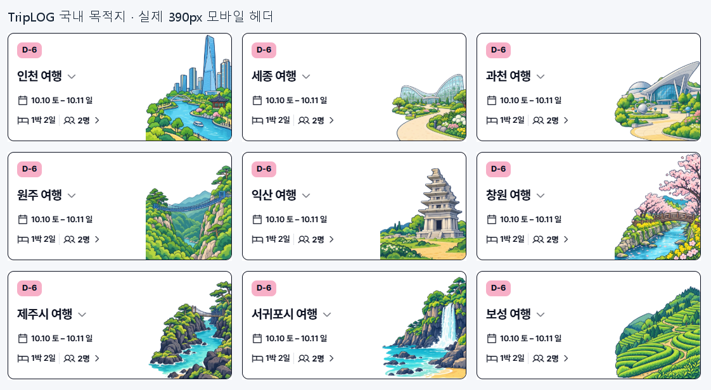

# 국내 목적지 삽화 최종 검증

2026-10-17 로컬 구현·검증 완료. 공식 시 단위 85곳에 종전 광주 도시권과 기존 군·섬·제주도 권역을 더한 **국내 95곳** 모두 PC·모바일 전용 그림을 사용한다. 기존 15쌍을 유지하고 신규 80쌍·160장을 생성했다. 해외 300곳을 합친 전체 목적지는 395곳이며, 공통 테마 10쌍을 포함한 활성 그림은 810개다.

## 검증 결과

| 검사 | 결과 |
| --- | --- |
| 공식 명부·국내 카탈로그 집합 | 85개 시 단위 및 별도 보존 10곳, 누락·중복 0 |
| 신규 원본·보존본 SHA256 | 160/160 일치, 고유 원본 160개 |
| 최종 WebP 크기·투명도·해시 | 160/160 통과, PC 800×480 / 모바일 480×600 |
| 기존 국내 그림 보존 | 30개 기존 파일 SHA256 일치 |
| 국내 전체 화면 | 95곳 × 320·390·599·1440px = 380조합 통과 |
| 전환점·중간 패널 추가 검사 | 12곳 × 320·390·599·600·613·767·768·1000·1440px = 108조합 통과 |
| 여행 헤더 기능 검사 | 여행 전환·재로딩·키보드·멤버창·긴 제목·비정상 값·실패 대체 통과 |
| 이미지 캐시 검사 | 필요한 비율 한 장만 로드, 오프라인 재표시·미캐시 대체·온라인 복귀·48개 한도 통과 |
| `npm test` | 통과 |
| `npm run artifacts:check` | 통과 |
| `npm run test:source` | 통과 |
| `npm run build` | 통과 |
| 신규 소스와 dist WebP SHA256 | 160/160 일치 |
| `git diff --check` | 통과 |

빌드 지문은 `716507a4b95c46bf7dd7`이다. `Travel.html`과 `sw.js`의 생성 변경을 확인했다. 신규 실행 WebP 총 용량은 **15,401,632 bytes(15.40 MB)**이며 한 화면에서 선택된 이미지 한 장만 요청한다. `dist/artifacts`는 없고 원본·프롬프트·QA 자료는 배포에 포함되지 않는다.

수치 근거는 [요약 JSON](verification-summary.json), [자산 감사](asset-audit.json), [488개 화면별 지표](header-verification.json)에 기록했다. 전체 로그와 488개 원본 캡처는 Git 제외 경로 `artifacts/tmp/20261017-domestic-city-expansion/`에 보관한다.

## 육안 검토와 교정

기존 순천 그림을 기준으로 짙은 외곽선·밝은 자연색·투명 실루엣·정보 왼쪽/삽화 오른쪽 배치를 유지했다. 신규 그림은 기존 v2보다 건축·수목의 세부 묘사가 촘촘하고 일부 녹색의 채도가 높다. 원본 확대 비교와 실제 390px 헤더에서 검토했으며, 지역별 주 소재와 정보가 구분되어 읽히는 상태로 확정했다.

이미지 전수 검토에서 발견한 문제는 교정했다. 과천의 비율과 지붕 잘림, 세종 온실의 날개, 나주·양산·영주의 건물 끝, 서산 성문의 아치, 당진의 근거 없는 전망탑, 원주 PC·모바일 다리 색상 불일치, 보성의 불필요한 물 표현을 수정했다. 양주 모바일 하단의 7px 투명 여백은 기술 변환으로 제거했다. 모든 이전 생성 원본과 기록을 디자인 폴더의 `pilot-attempts/` 또는 `revisions/`에 SHA256 대조 후 보존했다.

최종 488개 화면에서 제목과 삽화 겹침, 가로 넘침, 이미지 로딩 실패가 없었다. 채색 픽셀과 카드 테두리 사이의 최대 측정 간격은 아래·오른쪽 모두 **1.41 CSS px**로 2px 기준을 통과했다. 320·390px, 599/600px·767/768px 양쪽, 613px 중간 폭과 1440px PC를 비교했다. [390px 예시](header-examples-390.png), [PC 양산](kr-yangsan-1440.png), [긴 제목 320px](long-title-320.png), [긴 제목 390px](long-title-390.png), [긴 제목 768px](long-title-768.png), [긴 제목 PC](long-title-1440.png)를 보존한다.

독립 코드 검토에서도 수정이 필요한 회귀를 찾지 못했다. 기존 해외 300개 항목은 새 `canonicalInput` 필드 외에 동일했고, 기존 1,250개 국가·도시 별칭의 `destinationId`·`match` 비교에서 변화가 없었다. 제주시·서귀포의 새 전용 그림, 경기 광주와 종전 광주 도시권의 구분은 별도 테스트로 확인했다. 선택 함수는 저장된 여행 데이터를 변경하지 않는다.

## 전체 그림과 재현 자료

[그림 비교 1](assets-contact-01.png) · [2](assets-contact-02.png) · [3](assets-contact-03.png) · [4](assets-contact-04.png) · [5](assets-contact-05.png) · [6](assets-contact-06.png)

[제작 기록](../../design/20261017-domestic-city-expansion/README.md), [95곳 체크리스트](../../design/20261017-domestic-city-expansion/city-checklist.md), [생성 작업 목록](../../design/20261017-domestic-city-expansion/job-manifest.json)에 최종 프롬프트와 호출 원본 경로를 연결했다. 모든 생성은 독립 T2I이며 이미지 입력은 없다. 이 보고서는 로컬 결과이며 커밋·푸시·자동 배포는 수행하지 않았다.
