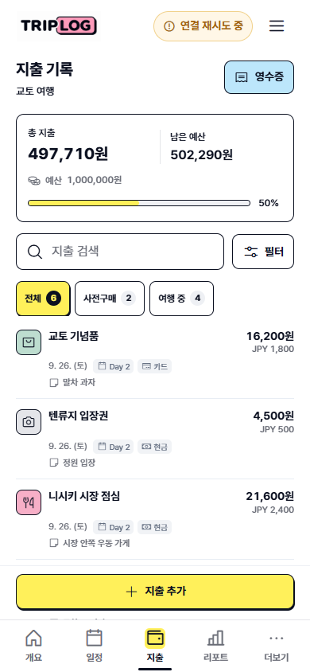
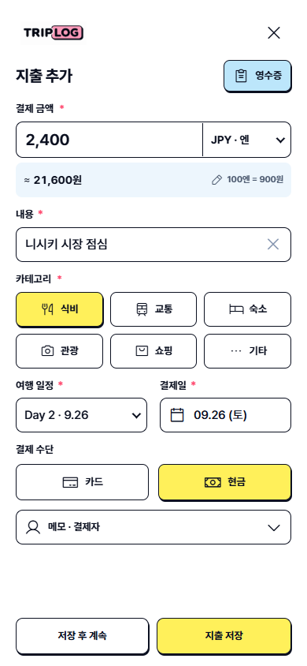
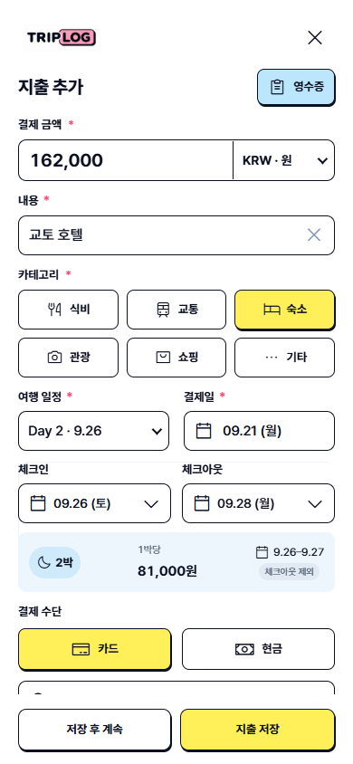

# 지출 화면 가독성 개선 · 2026-09-21

## 조사 결과와 반영

- 기존 보조 예산 금액은 typography.css의 우선순위로 18px까지 커져 총 지출과 시각적으로 경쟁했다. 총 지출 20px, 남은 예산 16px, 예산 메타 12px로 위계를 분리했다.
- 목록은 날짜·카테고리·결제수단·메모가 문장처럼 반복됐다. 카테고리 색상/아이콘, Day 및 결제수단 배지, 한 줄 메모로 변경했다. 원본 메모는 편집창에 그대로 보존한다.
- 외화 환산은 파란 띠의 `≈ 원화 금액`과 편집 가능한 환율로 표시한다. KRW에는 불필요한 환산 문장을 표시하지 않는다. 환율 누락과 잘못된 날짜는 수정 방법을 알려주는 텍스트를 유지한다.
- 숙박비는 체크인/아웃 두 필드, 박 수 배지, 1박 금액, 적용 날짜 범위로 표현한다. 나누어 떨어지지 않는 1박 금액에는 `약`을 붙이고, 실제 저장의 정수 배분 방식은 유지한다.
- 선택된 카테고리·결제수단의 노란 배경이 공통 hover 규칙으로 덮이지 않도록 했다. 폼 제목/금액은 20px, 레이블은 13px이며 편집 가능한 일반 입력은 16px, 주요 터치 영역은 44px를 유지한다.

## 생성한 디자인 기준

- [지출 목록 목업](../../triplog-expense-ledger-mockup-20260921.png)
- [지출 입력 목업](../../triplog-expense-editor-mockup-20260921.png)
- [숙박비 목업](../../triplog-expense-lodging-mockup-20260921.png)

각 에셋은 built-in Image Gen으로 한 번 생성했다. 입력 화면, 최종 프롬프트, 편집 모드, 덮어쓰기 여부는 각 `.prompt.json`에 남겼다. 생성 이미지의 예시 값과 실제 데이터가 다를 때 실제 데이터를 우선했다. 숙소 입력에도 결제일/여행 일정은 필요한 기존 필드이므로 유지했다.

## 실제 구현 화면

| 모바일 목록 | 외화 지출 입력 | 숙박비 입력 |
| --- | --- | --- |
|  |  |  |

[데스크톱 목록](ledger-desktop.png) · [데스크톱 입력](editor-desktop.png) · [320px 입력](lodging-320.png) · [320px 긴 내용](ledger-long-320.png)

## 검증 범위

`scripts/expense-ui-browser-regression.js`는 외부 요청을 차단한 격리된 fixture만 사용한다. 실제 사용자 계정/여행은 수정하지 않는다. Browser plugin unavailable: 기존 Playwright/Edge 경로를 사용했다.

- JPY 2,400 × 환율 900원/100엔 → 21,600원 표시, 저장, 새로고침 후 재편집.
- 환율 누락 제출 차단, KRW 전환 시 환산 띠 숨김, 결제수단과 메모/결제일 보존.
- 키보드로 항목 편집, 카테고리 단일 선택 및 hover 후 색상 유지.
- 162,001원 2박 배분: 9/26 및 9/27 두 항목, 총액 보존, 체크아웃 9/28 제외.
- 잘못된 숙박일 입력 차단, 저장 후 계속 흐름.
- 검색/카테고리/시기 탭/정렬/초기화, 결과 합계, 초과 예산/미설정 예산/빈 목록.
- 1440px, 390px, 320px 레이아웃과 긴 내용/큰 금액 가로 넘침 점검.

실제 iPhone Safari 기기 검증은 수행하지 않았다.

운영 반영: `expense-polish-20260921-1`, 배포 ID `b63f47fc`. `npm test`, `npm run test:browser`, Chrome 지출 검사, 운영 기본 주소에서 동일한 격리 지출 검사까지 통과했다. 배포된 핵심 파일 6개의 SHA-256이 로컬 빌드와 일치한다.
