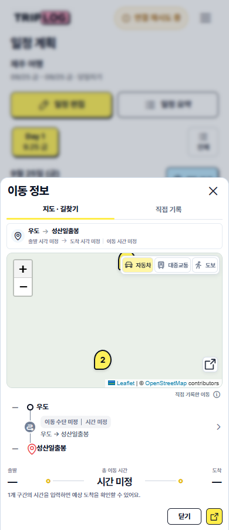
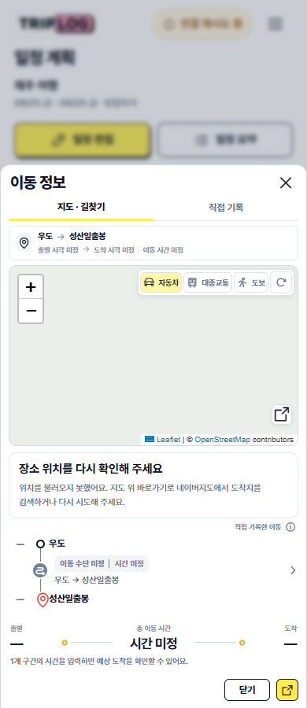
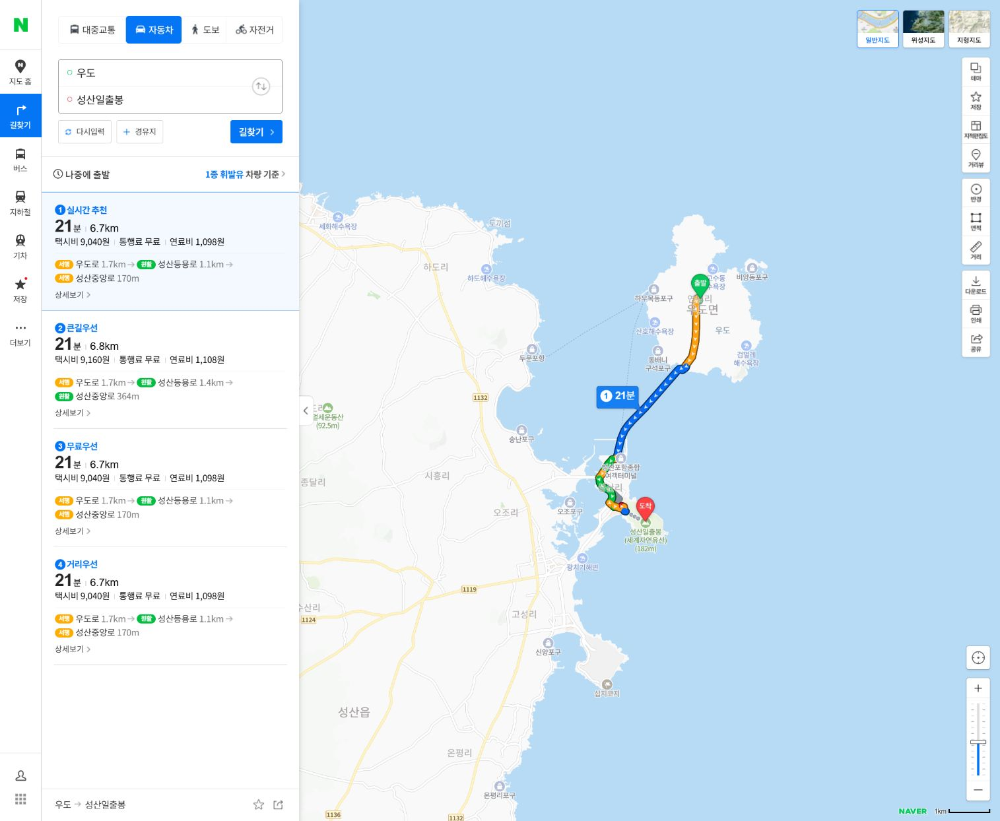

# 국내 이동정보에서 네이버지도 바로 열기

국내여행의 이동정보 지도 오른쪽 아래 바로가기 버튼은 출발지·도착지가 있으면 위치 조회 중이거나 실패해도 사용할 수 있습니다. 위치가 확인되면 선택한 자동차·대중교통·도보 경로를 네이버지도에 전달하고, 확인되지 않으면 여행 지역을 포함한 도착지 검색으로 연결합니다. 버튼의 접근성 이름과 툴팁도 실제 연결 대상에 맞춰 바뀝니다.

모바일은 같은 탭에서 네이버지도로 연결하며 돌아왔을 때 저장 전 이동 입력을 복원합니다. PC는 새 탭을 사용합니다. 출발지나 도착지 자체가 미정인 경우에는 기존 장소 입력 안내를 유지합니다. 기존 지도 바로가기 버튼의 위치와 스타일을 재사용한 동작 수정으로, 별도의 디자인 목업이나 스타일 변경은 없습니다.

## 검증

- `npm run test:maps` 통과.
- `domestic-route-browser-regression.js`: 위치 조회 전·후·실패 시 지도 위 버튼, 접근성 이름, 여행 지역이 포함된 검색 링크, 3가지 이동수단, 실제 클릭 가능한 위치, PC 새 탭, 모바일 이동/뒤로 가기와 저장 전 입력 복원, 좌표 조회가 일정을 수정하지 않는 것을 확인했습니다.
- `map-provider-browser-regression.js`: 국내 네이버/해외 Google 분기, 좌표 없는 경우, 전체 동선·오늘/예약 지도, 초안 보존 통과.
- `transit-journey-browser-regression.js`: 기존 해외 지도 바로가기, 320/390/768/1536px 배치, 직접 기록의 저장·취소·색상·시간 및 모바일 복원 통과.
- `npm run build` 통과. 운영 반영은 [별도 검증 기록](production-verification.json)으로 확인합니다.
- Browser 플러그인이 없어 저장소의 격리 Playwright/Edge 테스트를 사용했습니다. 실제 앱 데이터는 변경하지 않았으며 외부 이동은 합성 페이지로 가로채서 검사했습니다. 자동 검사의 지도 타일은 시험용입니다.
- 별도로 인앱 브라우저에서 공개 예시 `우도 → 성산일출봉` 링크를 실제 네이버지도에 열었습니다. 현재 네이버 길찾기 화면으로 리디렉션되고, 출발지·도착지·자동차 선택과 실제 경로가 표시되는 것을 확인했습니다.

## 화면

