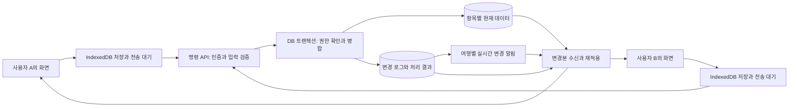

# TripLOG 실시간 공동 여행 서비스 설계·구현 계획

버전: 4 · 작성: 2026-09-19 KST · 상태: 설계만 작성, 구현·배포 전

이 문서가 현재 구현 기준이다. 기존 저장 유실 방지 요구사항과 7개 재현 시나리오는 모두 유지하고, 항목별 동시 편집·자동 병합·실시간 전달·오프라인 재연결·운영 체계까지 확장한다. 전체 여행 스냅샷의 버전이 다르면 모든 편집을 멈추는 방식을 최종 구조로 사용하지 않는다.

구현에 필요한 API 계약·상태 전이·여행 도메인 세부 규칙·보안·접근성·출시 게이트·작업 목록은 [서비스 구현·출시 상세 명세](service-readiness-spec.md)에 정의한다. 두 문서를 함께 적용하며 API·큐·보관 정책의 구체적인 경계 조건은 상세 명세를 따른다.

## 1. 사용자가 경험할 동작

여행을 함께 계획하는 사람들이 각자의 휴대폰과 PC에서 일정을 수정하면 다른 사람의 화면에도 자동으로 반영된다. 일반 화면의 수동 동기화 버튼과 메뉴는 제거하고 저장·연결 상태 표시로 교체한다. 저장된 변경의 전송, 다른 사람의 변경 수신, 재연결, 누락 복구는 자동으로 실행한다.

사용자가 누르는 일정·지출의 ‘추가/저장’은 작성 내용을 확정하는 동작으로 유지할 수 있다. 확정 후 서버 반영을 위해 별도의 동기화 조작을 요구하지 않는다. 미완성 입력은 초안으로 보관하며 삭제·초대·공유 범위 변경 같은 의도적인 작업을 자동 저장 때문에 임의로 실행하지 않는다.

| 동시에 일어난 작업 | 기대 동작 |
|---|---|
| A가 26일 식당 추가, B가 27일 관광지 추가 | 두 일정 모두 자동 반영 |
| 같은 일정에서 A가 장소 수정, B가 시간 수정 | 두 변경을 자동 병합 |
| 같은 일정의 시간을 A는 12시, B는 13시로 수정 | 해당 시간만 비교하여 해결; 나머지 작업은 계속 가능 |
| A가 지출 추가, B가 준비물 완료 표시 | 각 화면·예산·완료율에 독립 반영 |
| 공동 메모의 서로 다른 부분을 동시 입력 | 글자 단위로 병합하고 참여자의 커서 표시 |
| A가 일정 삭제, B가 그 일정을 오프라인에서 수정 | 삭제를 몰래 취소하지 않고 B의 수정본을 보존해 복구 선택 제공 |
| 지하철에서 연결이 끊긴 동안 편집 | 기기에 보관하고 연결 복구 후 변경을 교환 |
| 다른 사람이 편집하는 동안 내 입력창이 열려 있음 | 내 입력·커서·스크롤 유지, 충돌 없는 외부 변경만 반영 |
| 멤버 권한이 회수됨 | 이후 서버 읽기·쓰기 거부, 대기 작업을 다른 계정으로 전송하지 않음 |

첫 서비스 범위는 공동 일정, 이동 구간, 지출·정산, 예약, 준비물, 동행자와 초대, 공동 메모, 변경 기록이다. 수정자 표시·댓글·담당자 지정·여행 내 알림을 같은 항목 ID와 권한 구조 위에 연결한다.

## 2. 결정한 기본 아키텍처

- 화면 배포는 현재 정적 웹 호스팅을 유지한다.
- 서버의 확정 데이터는 Supabase PostgreSQL의 항목별 테이블에 저장한다.
- 쓰기는 Supabase Edge Function의 명령 API를 거쳐 DB 트랜잭션으로 처리한다.
- 실시간 알림은 여행별 비공개 Supabase Realtime Broadcast 채널을 사용한다.
- 접속자·현재 편집 항목 표시는 Presence를 사용한다. Presence는 저장이나 편집 권한의 근거가 아니다.
- 브라우저는 IndexedDB에 서버 확정본, 전송 대기 명령, 작성 중 초안, 수신 위치를 보관한다.
- 일반 일정·금액·예약 필드는 변경한 필드 묶음의 버전으로 병합하고, 긴 공동 메모는 Yjs 문서로 관리한다.

Broadcast를 빠른 변경 알림으로 사용하고, 클라이언트가 실제 데이터를 적용할 때는 접근 권한이 확인되는 동기화 API에서 확정된 변경분을 받는다. 메시지 수신이나 WebSocket ACK를 DB 저장 완료로 간주하지 않는다. Supabase도 일반적인 DB 변경 구독에는 Broadcast 사용을 권장한다. [공식 가이드](https://supabase.com/docs/guides/realtime/subscribing-to-database-changes)

## 3. 여행 한 덩어리를 항목별 데이터로 분리

아래 이름은 논리 모델이며 실제 테이블 이름에는 기존 `triplog_` 접두어를 적용한다.

| 모델 | 역할·주요 관계 |
|---|---|
| trips | 여행명, 기간, 시간대, 기본 통화, 소유자, 협업 프로토콜 버전 |
| trip_members / invitations | 계정별 owner/editor/viewer 권한, 만료·취소·사용 제한이 있는 초대 |
| participants | 실제 여행·정산 참여자; 계정이 없는 가족도 포함, 로그인 멤버와 구분 |
| itinerary_items | UUID가 있는 개별 일정, 날짜·시간·장소·순서·상태 |
| transit_segments | 이동 구간 UUID, 출발·도착 일정 ID, 교통수단·시간·비용 |
| expenses / expense_shares | 개별 지출과 참여자별 부담 금액, 일정·예약 연결 |
| reservations | 예약 정보, 일정·지출 연결, 공개 범위 |
| packing_items | 준비물, 담당자, 완료 여부 |
| notes / note_updates / note_snapshots | 공동 메모 문서와 Yjs 변경분·압축 기준본 |
| comments / activity | 항목별 대화와 사용자가 읽는 변경 기록 |
| operation_receipts | 요청 ID, 요청 해시, 처리 결과, 재시도 확인 |
| change_log / stream_heads | 확정 변경분과 스트림별 수신 순서 번호 |
| notification_outbox | 커밋 후 실시간 변경 알림 전송·실패 재시도 |
| recovery_snapshots | 복구 시점별 일관된 사본과 복원 출처 |
| attachments | 파일 메타데이터, 소유권·여행 권한, 업로드 확정 상태 |

### 데이터 규칙

- 여행과 하위 항목은 안정적인 UUID로 참조한다. 배열 위치, 이름, 이메일, 기기 시각을 식별자로 쓰지 않는다.
- 모든 하위 항목에 여행 ID를 두고 복합 외래키 등으로 다른 여행의 일정·지출을 잘못 연결하지 못하게 한다.
- 항목 버전, 필드 묶음별 변경 버전, 수정자, 서버 수정 시각, 삭제 상태를 관리한다.
- 삭제는 동기화에 필요한 삭제 기록을 남긴다. 오래된 오프라인 수정이 삭제된 항목을 자동 재생성하지 못한다.
- 금액은 통화에 맞는 최소 단위 정수 또는 고정 소수점으로 저장하고, 환율·원금·환산값·분담 합계를 서버에서 검증한다.
- 여행 날짜·시각은 여행 시간대 기준으로 다루고 이벤트 시각은 UTC로 기록한다. 사용자의 기기 시간으로 충돌 승자를 정하지 않는다.
- 기존 `travel_state`는 이관 원본·내보내기용 표현으로 남길 수 있으나 신규 공동 편집의 쓰기 원본으로 사용하지 않는다.
- 기존 비공유 데이터는 자동으로 업로드하지 않는다. 공유 여행 데이터, 개인 계정에만 동기화할 데이터, 이 기기에만 보관할 데이터를 구분한다. 개인 클라우드 동기화는 사용자가 해당 범위를 선택한 뒤 적용한다.

인덱스는 멤버십 `(trip_id,user_id)`, 일정 `(trip_id,date,position,id)`, 변경 로그 `(stream_id,seq)`, 요청 식별자, 삭제되지 않은 항목 조회 및 외래키를 우선한다. 실제 실행계획과 권한 검사를 포함하여 검증한다.

## 4. 전체 저장 대신 변경 명령을 전송

예시 명령:

- `itinerary.create`, `itinerary.patch`, `itinerary.move`, `itinerary.delete`
- `transit.patch`, `expense.create`, `expense.patch`, `expense.delete`
- `packing.setChecked`, `reservation.patch`, `comment.create`
- `schedule.shift`, `operation.undo`, `snapshot.restore`

공통 봉투에는 `protocolVersion`, `operationId`, `clientId`, `tripId`, `entityId`, 명령 종류, 변경한 필드, 필드 묶음별 기준 버전, 선행 명령 ID를 담는다. 작성자 계정은 요청 본문을 믿지 않고 인증된 세션에서 결정한다.

### 서버 처리 순서

1. Edge Function에서 세션·프로토콜·명령 종류·크기·요청 빈도를 검증한다.
2. DB 트랜잭션 안에서 현재 멤버십·역할을 다시 확인한다. 권한 변경과 경합하는 경우에도 적용 순간의 권한을 검사한다.
3. `(trip_id, actor_id, operation_id)`로 중복 요청을 확인한다. 같은 ID와 다른 내용은 오류로 거부한다.
4. 변경 대상과 필요한 관련 항목을 일정한 순서로 잠그고 필드별 병합 조건과 도메인 규칙을 검사한다.
5. 항목 변경·관련 지출 갱신·요청 처리 결과·변경 로그를 함께 커밋한다.
6. 확정 항목 버전, 스트림 순번, 처리된 요청 ID를 반환한다. 같은 트랜잭션에 기록한 알림 대기열을 커밋 후 Broadcast로 전달한다. 즉시 전송 경로와 실패 재시도 워커를 두고 중복 알림을 허용하되 클라이언트는 중복 적용하지 않는다.

실시간 전송 장애 때문에 이미 저장한 변경을 취소하지 않는다. 알림 실패 시에도 변경 로그로 복구할 수 있다. 명령 처리 트랜잭션에는 지도·경로 조회 같은 외부 HTTP 요청을 포함하지 않는다.

### 쓰기 경계와 접근 제어

일반 브라우저 역할은 새 항목 테이블을 직접 임의 수정할 수 없게 하고 명령 API를 사용한다. Edge Function 내부의 서버 자격 증명으로 호출하는 저장 RPC는 `SECURITY INVOKER`를 기본으로 하며 서버 역할에만 실행을 허용한다. RPC는 서버에서 전달한 검증된 actor의 여행 멤버십과 명령별 권한을 자체 확인한다. 임의 테이블·SQL·필드를 전달하는 범용 프록시는 만들지 않는다.

서버 비밀키는 브라우저에 넣지 않는다. 일반 읽기·파일 접근·이력 조회에는 RLS를 적용한다. 구버전의 전체 스냅샷 UPDATE와 다른 우회 쓰기 경로가 차단되는지 별도로 테스트한다.

## 5. 충돌 대부분을 자동으로 해결하는 규칙

### 구조화된 데이터

필드 하나 또는 서로 의존하는 필드 묶음에 변경 버전을 둔다. 기준 버전과 현재 버전이 달라도 이번 명령이 건드리는 필드 묶음이 바뀌지 않았다면 자동 적용한다. 이미 같은 최종값이라면 중복 없는 성공으로 정리한다.

| 대상 | 병합 규칙 |
|---|---|
| 서로 다른 일정·지출·준비물 | 독립 적용 |
| 같은 일정의 장소와 시간 | 서로 다른 필드 묶음이면 자동 병합 |
| 날짜·시작·종료 시각·시간대 | 유효한 일정으로 유지되도록 하나의 의미 단위로 검증 |
| 장소명·주소·좌표·지도 식별자 | 함께 검증; 옛 좌표와 새 장소를 섞지 않음 |
| 지출 원금·통화·환율·분담 | 연관 값을 함께 검증; 충돌 금액을 임의 평균·합산하지 않음 |
| 준비물 완료 | toggle 대신 `checked=true/false` 명령; 같은 값은 중복 성공 |
| 같은 필드의 서로 다른 값 | 이 필드에만 충돌 후보 보관·선택 UI 제공 |
| 삭제와 수정 | 삭제 기록 확인 후 수정 후보를 보존; 명시적 복원 없이는 부활 금지 |
| 일정 이동·순서 | 항목 ID와 앞뒤 기준 항목으로 이동 의도 표현, 안정적인 정렬값으로 순서 결정 |

동시에 같은 위치에 두 항목을 넣어도 둘 다 남고 순서는 모든 기기에서 같아야 한다. 같은 항목의 서로 다른 이동은 충돌로 다룬다. 기준 항목이 삭제된 이동은 재계산 가능한지 검사하고 불가능하면 이동만 확인받는다.

일정 일괄 시간 조정·날짜 교환·이동비의 지출 연동·분담 재계산은 하나의 도메인 명령으로 처리한다. 관련 항목의 기준 버전과 검증이 모두 통과해야 함께 반영하고, 중간 상태는 다른 기기에 보여주지 않는다.

### 같은 문장을 함께 쓰는 공동 메모

긴 공동 메모에는 Yjs를 적용한다. Yjs 업데이트는 순서가 달라지거나 중복 수신돼도 병합할 수 있으므로 글자 단위 협업에 적합하다. 모든 업데이트를 받아야 같은 문서로 수렴한다. [Yjs 공식 업데이트 API](https://docs.yjs.dev/api/document-updates)

- 문서별 권한과 업데이트 요청 ID를 검사하고, 서버에 영속 저장한 뒤 동기화 완료로 표시한다.
- IndexedDB에 로컬 업데이트를 저장하며 재연결 시 누락된 업데이트를 교환한다.
- 업데이트 로그를 주기적으로 압축하되 기준 스냅샷·수신 커서와 일관성을 유지한다. 임의 순서·중복·장기 오프라인 후 수렴을 검증한다.
- 서버 측에서 업데이트 유효성과 최대 문서·업데이트 크기를 제한한다. 파서·압축 작업은 자원 한도가 있는 서버 작업으로 분리한다.
- 커서와 선택 영역은 가벼운 임시 이벤트로 보낸다. 매 키 입력을 Presence 상태나 영구 활동 기록으로 기록하지 않는다.
- 사용자가 누르는 되돌리기는 자신의 편집 범위를 기준으로 구현하고 다른 사람의 후속 내용을 지우지 않는지 확인한다.
- 한국어·일본어 IME 조합과 모바일 선택 영역을 테스트한다.

같은 예약 시각이나 금액에 대한 서로 다른 의도는 자동으로 추측하지 않는다. 충돌은 그 항목에만 표시하고, 다른 사람의 편집과 다른 항목의 전송은 계속 진행한다.

## 6. 실시간 수신과 연결 복구 프로토콜

### 확정 데이터와 알림의 분리

- 여행의 공유 데이터는 공유 스트림에, 개인 데이터는 별도의 사용자 전용 스트림에 기록한다.
- 서버는 스트림별 순번을 항목 변경과 같은 트랜잭션에서 증가시킨다. 초기에는 여행별 짧은 잠금으로 커밋 순서를 보장하고 전역 잠금을 사용하지 않는다.
- Broadcast에는 여행·스트림·변경 순번·프로토콜 등 필요한 최소 알림만 싣는다. 예약번호·지출 세부내역·파일·개인 메모를 직접 방송하지 않는다.
- 클라이언트는 `sync_changes(after_seq, limit)` 형태의 읽기 API로 허용된 확정 변경을 받고 적용한다.
- 변경을 적용한 데이터와 수신 커서를 같은 IndexedDB 트랜잭션에 저장한다.

### 처음 열 때

1. 해당 계정의 로컬 확정본과 전송 대기 명령을 먼저 읽어 화면을 구성한다.
2. 현재 접근 권한과 비공개 채널 정보를 확인하고 구독한다. 구독 중 들어오는 알림은 잠시 모은다.
3. 서버의 일관된 스냅샷과 그 스냅샷에 대응하는 순번을 함께 받는다. 서로 다른 DB 읽기 시점의 데이터와 순번을 조합하지 않는다.
4. 그 순번 이후의 로그를 받아 구독 준비·스냅샷 조회 사이에 생긴 변경도 적용한다.
5. 서버 확정본 위에 로컬 대기 명령과 초안을 다시 적용하고, 유효한 대기 명령을 전송한다.

### 연결이 끊기거나 앱으로 돌아올 때

- 마지막 영속 수신 순번부터 로그를 다시 받아 누락을 채운다.
- 중복·역순 이벤트는 순번과 요청 ID로 정리한다.
- 로그 보관 범위를 벗어난 오래된 기기는 새 스냅샷을 받되, 로컬 대기 명령을 별도로 보존하고 다시 적용한다.
- 마지막 알림 하나만 사라진 경우도 감지하도록 활성 화면에서 주기적으로 서버 최신 순번을 확인한다. 실시간 연결 장애 시 제한된 폴링으로 전환한다.
- 통신 재시도는 지수 지연과 무작위 분산을 적용한다. 권한 오류·삭제 충돌·검증 실패를 무한 재시도하지 않는다.
- 한 항목의 충돌이 관련 없는 항목의 전송을 막지 않도록 의존성이 있는 명령만 같은 순서로 묶는다.

Supabase Broadcast Replay도 사용할 수 있지만 현재 문서상 재생 개수는 최대 25개이며 DB Broadcast 메시지는 3일 후 삭제된다. 앱의 장기 복구·오프라인 동기화는 자체 변경 로그와 스냅샷으로 보장한다. [공식 Broadcast 문서](https://supabase.com/docs/guides/realtime/broadcast)

## 7. 브라우저 상태·렌더링·오프라인 설계

화면 상태를 다음 세 층으로 관리한다.

1. 서버에서 확정받은 데이터
2. 로컬에 영속 저장한 전송 대기 명령
3. 아직 완성하지 않은 입력 초안과 탭별 화면 상태

화면에 보이는 내용은 확정본 위에 대기 명령과 초안을 적용한 결과다. 서버 응답을 전역 `state` 전체에 덮어쓰지 않는다. 외부 변경을 받은 뒤에도 내 대기 작업은 다시 적용한다.

- 모든 사용자 변경은 공통 명령 계층을 통한다. 각 폼이 직접 배열을 바꾸고 전체 저장하는 코드를 단계적으로 제거한다.
- 기존 전역 `state`는 전환 중 렌더러가 읽는 호환 뷰로만 유지한다. 별도의 쓰기 원본으로 함께 운영하지 않는다.
- `render()` 전체 호출을 변경 항목·영향받는 집계만 갱신하는 흐름으로 분리한다.
- 입력 포커스, 커서, 날짜 선택, 열린 편집창, 스크롤을 유지한다. 다른 사람의 편집을 짧게 강조하되 내 입력 필드는 바꾸지 않는다.
- 원격 변경은 내 저장 이벤트를 다시 발생시키지 않도록 출처를 구분한다.
- 좌표·경로·OCR 등의 늦은 비동기 결과는 요청 당시 항목·입력 버전을 확인한 뒤 적용한다.
- 여러 탭의 큐 소유권은 IndexedDB의 트랜잭션 기반 임대로 조율하고, 임대 만료·중복 전송이 있어도 서버 요청 ID로 안전하게 처리한다. BroadcastChannel 알림만으로 잠금을 대신하지 않는다.
- 오프라인에서도 저장 가능한 앱 셸을 Service Worker로 제공한다. 계정별 데이터 캐시를 분리하고 인증 응답을 공용 캐시에 넣지 않는다.
- 서비스 워커 업데이트로 편집 중인 탭을 강제 새로고침하지 않는다. 로컬 저장 완료 후 새 버전으로 전환한다.
- iOS가 백그라운드 전송을 계속 실행한다고 가정하지 않는다. 화면 복귀 시 영속 큐로 재개한다.
- 오프라인에서는 저장된 일정·예약·지출·준비물을 사용할 수 있도록 하고, 온라인 지도가 필요한 기능은 연결 상태를 표시한다.

일반 필드의 자동 저장은 유효한 입력 단위·짧은 입력 지연·blur/명시적 저장에 맞춘다. 작성 중인 불완전한 금액·날짜와 IME 조합은 초안으로 보존하며 다른 사람에게 확정값으로 보내지 않는다.

### 자동 동기화 실행 기준

- 로컬 명령의 영속 저장이 완료되면 자동 전송 스케줄러를 깨운다. 현재 화면의 여행뿐 아니라 같은 계정의 접근 가능한 여행에 남은 대기 작업도 처리한다.
- 체크·등록·삭제처럼 확정된 동작은 바로 전송을 시도한다. 기존 항목의 연속 입력은 초기값 500ms 지연·유효 입력 기준 최대 2초 대기를 적용하고 실기기 성능에 맞춰 조정한다. 이 지연은 네트워크 전송을 묶는 용도이며 입력 초안 보존을 미루는 근거로 사용하지 않는다.
- 앱 시작·로그인 완료·인증 갱신·화면 복귀·네트워크 복구·실시간 재접속마다 권한과 수신 위치를 확인하고 필요한 변경을 받은 뒤 대기 작업을 안전하게 재개한다.
- `online` 이벤트나 소켓 연결 성공만으로 저장 완료를 표시하지 않는다. 서버 처리 결과와 수신 순번으로 확인한다.
- 일시적 오류는 같은 요청 ID로 지수 지연·무작위 분산을 적용해 자동 재시도한다. 충돌·입력 오류는 해당 의존 작업만 멈추고, 인증·권한 오류는 영향을 받는 계정 또는 여행의 전송을 멈추어 해결 방법을 표시한다.
- 정상 연결에서는 실시간 알림으로 수신하고, 활성 화면에서는 초기값 30초 간격의 최신 순번 확인으로 마지막 알림 유실을 보완한다. 숨겨진 화면은 폴링을 줄이고 복귀 즉시 확인한다.
- 자동 저장마다 토스트나 모달을 띄우지 않는다. 지속적인 상태 표시와 필요한 오류 안내를 사용한다.

상태 계산·오류별 동작·전송 조건의 상세 기준은 [자동 동기화 상세 명세](service-readiness-spec.md#자동-동기화-실행-정책)를 따른다.

## 8. 협업 화면과 권한

### 화면

- 현재 접속한 멤버와 ‘이 일정을 편집 중’ 표시
- 변경한 사람과 시각, 항목별 변경 강조
- 로컬 보관·전송 중·공유 완료·오프라인·충돌 상태
- 전체 화면을 막지 않는 항목별 충돌 패널
- 일정·예약·준비물의 댓글과 담당자
- 변경 기록과 내 작업 되돌리기
- 초대·역할 변경·멤버 제거·공유 범위 관리

### 수동 동기화 버튼을 대체할 상태 표시

| 표시 | 의미·행동 |
|---|---|
| 기기에 저장 중 | 아직 로컬 영속 저장이 끝나지 않음 |
| 저장 중 | 로컬에 보관한 확정 변경을 서버에 자동 반영 중 |
| 모두 저장됨 | 현재 여행의 전송 대상 변경과 필요한 첨부가 서버에서 확인됐고 미해결 작업이 없음 |
| 오프라인 · 변경 N건 보관 중 | 로컬 저장 확인, 연결 복구 시 자동 전송 |
| 확인 필요 | 해당 항목의 충돌·입력·권한 문제를 표시 |
| 기기에 저장하지 못함 | 입력을 유지하고 저장 공간·재시도·내보내기 안내 |

저장 상태와 수신 연결 상태를 구분한다. 내 변경 저장이 끝났어도 원격 최신 상태를 확인하지 못했다면 ‘내 변경 저장됨 · 최신 내용 확인 중’처럼 표시한다. 미완성 초안·기기에만 보관하는 항목·다른 여행의 대기 작업은 별도로 보여주어 ‘모두 저장됨’의 범위를 오해하지 않게 한다.

상태를 누르면 상세 내역을 볼 수 있지만 누르는 행위 자체가 전송이나 강제 수신을 시작하지 않는다. 지속적인 통신 오류에만 ‘다시 시도’를 제공하며 동일한 안전한 자동 전송 경로를 사용한다. 충돌에는 ‘변경 내용 확인’, 인증 만료에는 ‘다시 로그인’을 제공한다. ‘강제 덮어쓰기/서버로 강제 맞추기’를 일반 해결 버튼으로 두지 않는다.

헤더·여행 메뉴·일정 메뉴의 기존 동기화 진입점은 자동 전송과 재연결 시험이 통과한 뒤 함께 교체한다. 아직 자동 전송으로 전환하지 않은 기존 기능이 있으면 공통 버튼 제거 완료로 처리하지 않는다.

Presence는 접속 여부·현재 항목처럼 비교적 드물게 바뀌는 상태에 사용한다. 커서 같은 잦은 이벤트에는 별도 Broadcast를 제한된 빈도로 사용한다. [Presence 공식 가이드](https://supabase.com/docs/guides/realtime/presence)

### 권한과 개인정보

- owner: 여행 설정·멤버·초대·역할·복구 정책 관리
- editor: 허용된 공유 항목·댓글 편집
- viewer: 허용된 공유 항목 조회
- 초대 토큰은 충분히 무작위로 만들고 만료·취소·사용 제한·역할을 서버에서 검증한다. 초대 수락과 멤버 등록을 원자적으로 처리한다.
- 비공개 채널이라는 설정만으로 여행별 권한이 완성되지 않는다. 채널 구독에도 실제 멤버십 검사를 적용한다.
- Realtime 권한 검사는 연결 동안 캐시될 수 있으므로 탈퇴 시 클라이언트의 자발적 구독 해제에만 의존하지 않는다. 멤버십 변경 시 채널 세대를 바꾸고 새 세대는 현재 멤버만 구독하게 한다. 데이터 조회·명령 적용은 매번 현재 권한을 확인한다. [Realtime 권한 가이드](https://supabase.com/docs/guides/realtime/authorization)
- 이미 내려받은 데이터가 원격 권한 회수만으로 다른 사람의 기기에서 즉시 사라진다고 약속하지 않는다. 재연결 시 접근 범위와 로컬 보관 정책을 적용한다.
- 개인 데이터는 공유 스트림·활동 기록·푸시 내용·복구 이력 조회를 통해 우회 노출되지 않게 한다.
- 파일은 비공개 Storage 버킷에 저장하고 권한을 확인한 제한 시간 URL로 제공한다. base64 파일을 매 편집 이벤트나 여행 스냅샷에 반복 전송하지 않는다.
- 파일 업로드→항목 연결을 분리하고 확정되지 않은 업로드의 정리, 재시도, 파일 크기·형식 검증을 구현한다.

## 9. 복구와 되돌리기

세 종류의 기록을 구분한다.

- 동기화 로그: 끊긴 기기가 변경을 따라잡는 용도. 기본 30일 보관 후 스냅샷 기반 재동기화 제공.
- 사용자 변경·복구 이력: 누가 어떤 항목을 바꿨는지와 이전 값을 확인. 기본 30일 및 중요한 복구 시점 사본, 미해결 충돌 원본은 자동 정리 제외.
- 운영 백업: DB·파일 저장소의 서비스 장애 복구. 보존 정책과 복구 훈련을 별도로 운영.

단순 전체 스냅샷 복구로 다른 사람의 이후 편집을 지우지 않는다. 기본 복원은 별도 여행 또는 항목별 복원 명령이며 현재 버전 조건을 확인한다. 내 작업 되돌리기도 해당 작업의 역변경을 새 명령으로 생성하고 이후 타인의 수정과 충돌하면 확인한다.

삭제 기록·요청 처리 결과를 정리할 때 지원하는 오프라인 기간과 맞춘다. 아주 오래된 요청은 무조건 새 요청처럼 실행하지 않고 이관·재검증 대상으로 처리한다. 아직 처리되지 않은 로컬 명령을 서버 이력 보관 기간이 지났다는 이유로 지우지 않는다.

## 10. 실제 서비스 운영 기준

아래 수치는 초기 설계·시험 목표다. 현재 무료 프로젝트에서 이미 보장되는 성능이나 가용성이 아니다.

| 항목 | 초기 목표·검증 기준 |
|---|---|
| 일상적인 동시 편집 | 한 여행 10명, 합계 100개 연결을 기준으로 대표 시나리오 시험 |
| 로컬 입력 반응 | 대상 기기에서 p95 100ms 이내를 목표로 측정 |
| 온라인 변경 반영 | 안정적인 시험 네트워크에서 저장 동작부터 상대 화면 반영까지 p95 2초 이내 |
| 재연결 | 대표 여행 1,000항목·대기 100명령에서 상태 수렴 p95 10초 이내 목표 |
| 정확성 | 서버 확정 명령의 유실·중복 효과·계정 간 혼입 0건 |
| 충돌 품질 | 서로 다른 항목·독립 필드 편집에 불필요한 충돌 없음 |
| 서비스 가용성 | 공개 운영 목표 99.9%; 별도 측정·요금제·장애 대응 기반 마련 |
| 운영 복구 | 공개 운영 목표 RPO 15분 / RTO 4시간; 백업 방식과 실제 복원 훈련으로 충족 확인 |

RPO 목표는 서버에 확정된 데이터의 인프라 장애 복구에 적용한다. 아직 서버에 전송되지 않은 기기 데이터까지 서버 백업이 보호한다고 표시하지 않는다.

### 관측과 대응

- 저장 API 지연·오류, 서버 확정률, 실시간 전달 지연, 큐 최장 대기, 재접속·누락 재수신, 충돌률, DB 잠금 대기를 계측한다.
- `operationId`로 기기 저장→API→DB→상대 수신을 연결한다. 예약번호·메모·토큰·전체 여행 내용을 로그에 남기지 않는다.
- 운영자가 서버 장애와 사용자 입력 충돌을 구분할 수 있게 오류를 분류한다.
- 요청 빈도·파일 크기·접속 수·실시간 메시지·DB 저장량·이력 크기에 한도와 알림을 둔다.
- 인증 메일·초대 전달, 오류 추적, 백업과 복구 절차를 공개 운영 점검에 포함한다.
- Realtime 장애 시 저장 API와 제한된 재조회로 계속 동작하고 상태를 표시한다. DB 장애 시 로컬 대기 상태를 보존한다.

현재 프로젝트는 조사 시 Free 플랜이었다. 유료 운영에 필요한 백업·복구·실시간 한도·메일·저장소 비용을 실제 예상 사용량으로 산정하고 적용 전에 확인한다. 개발 단계에서 요금제 변경이나 유료 자원을 자동 생성하지 않는다. 일일 백업·PITR의 제공 범위는 공식 문서로 확인한다. [Supabase 백업](https://supabase.com/docs/guides/platform/backups)

## 11. 기존 서비스에서 안전하게 전환

1. 현재 서버와 브라우저 원본을 보존하고 유실 재현 테스트를 고정한다.
2. 새 스키마와 명령 프로토콜을 별도 개발·검증 환경에서 구현한다.
3. UUID 매핑을 기록하며 기존 여행 JSON을 항목별 구조로 이관한다. 날짜별 일정 수, 지출 수·합계, 예약·파일·분담 관계, 공유 범위를 대조한다.
4. 기준 없는 로컬 수정·중복 여행 ID는 삭제하지 않고 이관 검토함에 남긴다. 이름이나 일정 개수만 보고 자동 통합하지 않는다.
5. 새 구조의 시험 읽기 결과를 기존 렌더링과 비교한다. 두 구조가 독립적으로 쓰기를 받는 장기 이중 운영은 하지 않는다.
6. 여행별 `collaborationVersion`으로 전환 시점을 명확히 정한다. 전환한 여행의 구버전 전체 쓰기는 서버에서 거부한다.
7. 새 클라이언트의 첫 실행은 로컬 이관 완료 후 동기화를 시작한다. 기존에 열려 있는 구버전 탭·iPhone 캐시·Service Worker 교체 흐름까지 안내·검증한다.
8. 내부 테스트 여행→초대한 소규모 사용자→전체 여행 순으로 확대한다. 각 단계에서 기능 플래그로 신규 전송을 멈출 수 있게 한다.
9. 장애 시 신규 명령을 안전하게 중지하고 큐를 보존한다. 롤백 때문에 옛 무조건 덮어쓰기 경로를 다시 열지 않는다.

브라우저 전역 구조와 현재 UI는 점진적으로 유지하되 도메인 명령·저장소·동기화·화면 상태를 모듈로 분리한다. UI 프레임워크 교체를 협업 기능의 선행 조건으로 삼지 않는다. 테스트·버전 고정·마이그레이션·배포 절차는 서비스 수준으로 정리한다.

## 12. 구현 단계와 단계별 완료 조건

| 단계 | 구현 내용 | 다음 단계 진입 조건 |
|---|---|---|
| P0 데이터 보호 | 현행 위험 경로 차단, 저장 실패 전달, 기존 원본·이력 보존, 7개 회귀 테스트 | 더 이상의 조용한 전체 덮어쓰기 방지. 임시 단계임을 명확히 함 |
| P1 협업 데이터 기반 | 항목별 스키마, UUID 이관, 명령 API, 원자적 변경 로그·요청 중복 방지, IndexedDB 큐 | 일정 추가·수정·삭제를 두 독립 클라이언트가 주고받고 독립 필드 자동 병합 |
| P2 실시간 일정 협업 | 자동 전송 스케줄러, Broadcast, 누락 재수신, 재연결, 입력 유지, Presence, 순서 변경, 상태 표시·항목 충돌 패널 | 버튼 조작 없는 두 기기 실시간·오프라인 복귀·삭제 경합·두 탭 테스트 통과 |
| P3 여행 기능 전체 적용 | 이동 구간·지출·정산·예약·준비물·멤버·파일에 동일 프로토콜 적용, 공통 수동 동기화 진입점 제거 | 기능 간 관계·금액·권한 검증, 기존 모든 저장 경로의 자동 전송 및 상태 표시 검증 완료 |
| P4 공동 작업 경험 | Yjs 공동 메모·커서, 댓글·담당자·활동 기록, 안전한 undo·복구, PWA 오프라인 | 장기 오프라인·IME·문서 압축·개인정보 경계·실제 iPhone 시험 통과 |
| P5 공개 운영 준비 | 관측·제한·비용 계획·운영 백업·복원 훈련·점진 배포 | 성능 목표 측정, 장애·복구 훈련, 지원 절차와 운영 권한 준비 |

P2를 최초의 실시간 공동 일정 사용 가능 단계로 잡는다. 지출을 포함한 기존 전체 여행 기능이 안전하게 협업하려면 P3가 필요하며, 공개 서비스 완료는 P5까지 검증한 뒤 판단한다.

## 13. 필수 시험과 검증 자료

- 기존 7개 유실 시나리오를 그대로 회귀 검증한다.
- 수동 동기화나 새로고침 없이 모든 기존 기능의 변경이 서버와 다른 기기에 반영되는지 확인한다. 자동 재시도·첨부 전송·다른 여행의 대기·거짓 완료 표시도 검증한다.
- 동일 항목의 독립 필드·같은 필드·의미가 연결된 필드의 동시 편집을 구분해 검증한다.
- 생성→수정→삭제, 두 위치로 이동, 이동 기준 항목 삭제, 일괄 시간 변경과 개별 변경 경합을 시험한다.
- 지출 중복 방지·통화 소수 단위·환율·분담 합계·자동 연결 지출의 원자성을 확인한다.
- 메시지 중복·역순·일부 유실·마지막 메시지 유실·응답 유실·연속 재시도를 주입한다.
- 임의 순서로 생성한 명령 시퀀스를 반복 실행하여 처리된 명령과 최종 DB 결과를 대조한다. 대기·충돌이 해결된 모든 클라이언트가 같은 공유 상태로 수렴해야 한다.
- IndexedDB 실패·저장 공간 부족·앱 강제 종료·두 탭 리더 종료·계정 전환을 시험한다.
- 구버전 직접 쓰기·위조 actor·다른 여행 ID·탈퇴 직후 열린 채널·viewer 편집·비공유 이력·첨부 URL을 검증한다.
- snapshot과 순번의 경계, 오래된 커서, 로그 정리 후 재접속, 삭제 기록·요청 결과 정리 경계를 검증한다.
- Yjs 동일 문서의 동시·오프라인 편집, 업데이트 중복, 압축 전후, 문서 크기 제한, IME를 시험한다.
- 실제 iPhone Safari에서 지도 앱으로 이동 후 복귀, 화면 잠금, 비행기 모드, 새로고침, 홈 화면 설치 앱을 확인한다. 데스크톱 WebKit 자동화와 실제 기기 검증은 별도 기록한다.
- 스테이징에서 부하·권한·백업 복원을 검증하고 기존 사용자 여행을 테스트 데이터로 변경하지 않는다.

결과물은 명령·충돌 정책 명세, DB 스키마·마이그레이션, 자동 테스트, 기기별 검증 기록, 관측 화면, 복원 훈련 기록, 배포·롤백 절차다. 시연 화면에서 실시간으로 바뀌는 것만으로 완료 처리하지 않는다.

## 14. 주요 코드 분리와 배포 조건

- `persistence/`: 로컬 repository, 전송 큐, 초안, 마이그레이션, 복구 사본
- 신규 `sync/`: 명령 큐 실행, 수신 커서, 재연결, 병합, 충돌
- 신규 `domain/`: 일정·순서·금액·분담·권한별 변경 규칙
- `features/collaboration/`: 멤버·초대·Presence·공동 편집 상태와 API 연결
- `features/itinerary/`, `expenses/`, `packing/`, `travel-companion/`, `history/`: 명령 생성과 필요한 영역만 렌더링
- Supabase Edge Functions: 인증된 명령 진입점, 파일·문서 관련 제한된 서버 작업
- Supabase SQL: 테이블·인덱스·RLS·서버 전용 원자적 저장 함수·복구·실시간 알림
- 테스트: 도메인 단위, DB 통합·권한, 다중 클라이언트, 브라우저·기기, 부하·복구

현재 연결된 Supabase SQL 도구는 조사 시 읽기 전용 역할이었다. 실제 운영 마이그레이션·서버 배포에는 적절한 배포 권한이 필요하다. 권한·프로토콜·SDK 버전은 구현 직전에 확인한다.

최신 Supabase 변경에 따라 `realtime` 스키마 안에 앱 테이블·함수를 만들지 않는다. 앱 로그는 앱 스키마에 두고 문서화된 Broadcast 함수와 허용된 `realtime.messages` RLS 정책만 사용한다. [공식 변경 공지](https://supabase.com/changelog/realtime-schema-locked-down-against-modification)

이 계획의 완료 기준은 ‘여러 사람이 자연스럽게 함께 편집하고, 연결 장애 후에도 올바르게 수렴하며, 충돌·실수·서비스 장애의 결과를 설명하고 복구할 수 있는 여행 서비스’다.
