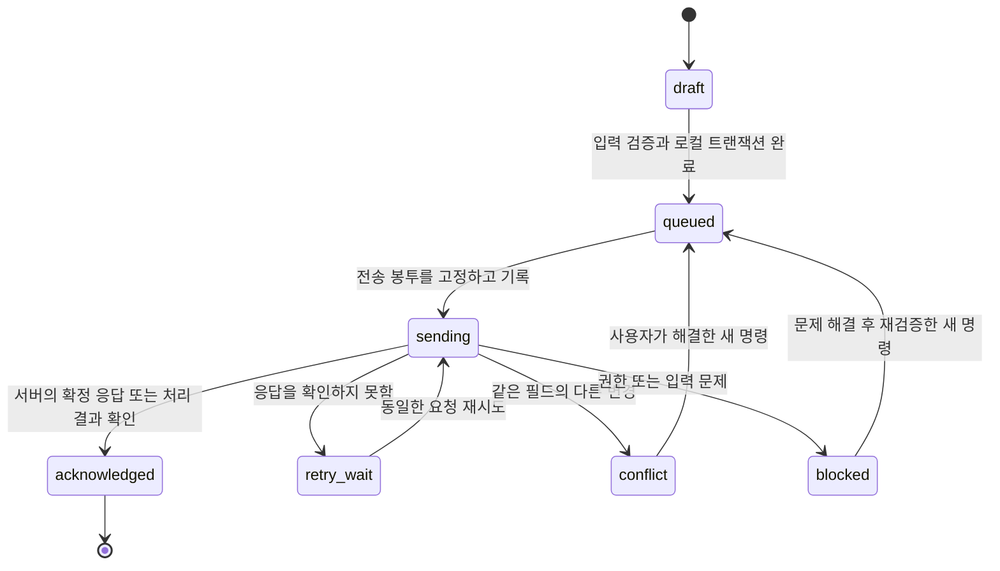

# TripLOG 서비스 구현·출시 상세 명세

작성: 2026-09-19 KST · 적용 대상: 실시간 공동 여행 서비스 설계 v4

이 문서는 [실시간 협업 계획](realtime-collaboration-plan.md)의 구현 계약과 출시 기준이다. 기능을 나열하는 데서 끝내지 않고 실패 상황·경계 조건·우선순위·완료 증거를 정의한다. 현재는 계획이며 운영 성능, 백업, 보안 인증, 접근성 적합성을 달성했다고 주장하지 않는다.

## A. 제품 기준과 사용자 여정

### 기본 가정

- 첫 대상은 혼자 또는 가족·친구 2~10명이 함께 계획하고 사용하는 국내외 여행이다.
- 모바일 Safari와 Chrome을 주요 사용 환경으로 하고 PC의 긴 일정 편집도 지원한다.
- 한국어를 기본으로 하되 데이터·날짜·통화·문구를 다국어 확장이 가능한 구조로 분리한다.
- 여행 전 계획, 여행 중 실행, 여행 후 정산·기록 보관을 하나의 여행 데이터로 연결한다.
- 로그인 계정과 실제 여행·정산 참여자는 별개다. 계정이 없는 가족을 참여자로 넣을 수 있다.
- 지도나 환율 공급자가 응답하지 않아도 이미 저장한 일정과 지출을 사용할 수 있어야 한다.

### 필수 여정

| 여정 | 필요한 동작 | 실패·이탈 시 보존할 내용 |
|---|---|---|
| 첫 방문→여행 생성 | 국가·도시·기간·시간대·기본 통화, 빈 여행 안내 | 작성 초안, 임시 여행 ID |
| 기존 여행 이관 | 현재 계정·서버 여행 ID 매핑, 사본 보존, 요약 비교 | 이관 원본, 실패 항목, 재개 위치 |
| 초대받아 참여 | 초대 대상·역할·공유 범위 확인 후 가입·수락 | 로그인 전 초대 의도, 민감 토큰의 불필요한 로그 금지 |
| 공동 계획 | 일정·시간·지도·메모·준비물·담당자 편집 | 입력 초안, 미전송 명령, 항목별 충돌 |
| 여행 중 | 오늘 일정·다음 장소·예약·현장 지출·완료 표시 | 오프라인 데이터와 미전송 작업 |
| 여행 후 | 최종 지출·분담·정산 상태·내보내기·보관 | 확정 정산 버전과 이후 추가 변경의 차이 |
| 기기 변경·재로그인 | 서버 확정본 복원, 해당 기기의 대기 작업 확인 | 기존 계정의 전송 대기열 |
| 멤버 탈퇴·권한 변경 | 서버 권한 반영, 개인 초안 분리, 소유권 처리 | 사용자가 작성했으나 반영되지 않은 초안 |

서비스 밖의 실제 항공·숙소 결제, 송금 실행, 공개 여행 상품 판매는 별도 사업·결제 범위로 구분한다. 현재 계획의 ‘예약’은 예약 정보를 관리하는 기능이며 ‘정산’은 계산·기록 기능이다. 이후 확장과 현재 저장 책임을 혼동하지 않게 UI와 문서를 작성한다.

## B. 정확성 불변조건

아래 조건을 자동 테스트와 운영 진단의 기준으로 삼는다.

1. 서버에서 성공으로 확정한 명령은 데이터·처리 결과·변경 로그가 함께 존재한다.
2. 같은 요청을 여러 번 받아도 같은 효과가 한 번만 발생한다. 전송 횟수가 한 번이라고 가정하지 않는다.
3. 항목별 독립 변경은 병합되고, 다른 의도를 임의로 선택한 경우를 성공적인 병합으로 간주하지 않는다.
4. 공유 상태는 모든 누락 변경 수신과 충돌 해결이 끝난 기기에서 동일하다.
5. 조회 권한이 없는 데이터는 현재 상태·과거 이벤트·파일·복구 기록 어디에서도 새로 제공되지 않는다.
6. 항목·파일·지출·참여자 관계가 다른 여행으로 연결되지 않는다.
7. 로컬 전송 대기 명령과 수신 커서는 데이터 변경과 원자적으로 기록된다.
8. 파생 합계·정산·일정 요약은 같은 확정 버전에서 계산하거나 재계산 중임을 표시한다.
9. 기기 시각 변경은 데이터의 우선순위·충돌 승자·처리 순서를 바꾸지 않는다.
10. 미전송·미해결 데이터를 공간 확보, 계정 전환, 업데이트를 이유로 자동 삭제하지 않는다.

## C. 변경 명령 API 계약

### 요청 예시

```json
{
  "protocolVersion": 2,
  "operationId": "uuid-request",
  "clientId": "uuid-device",
  "clientSequence": 28,
  "tripId": "uuid-trip",
  "entityId": "uuid-itinerary",
  "command": "itinerary.patch",
  "baseFieldRevisions": { "schedule": 7 },
  "patch": {
    "schedule": {
      "startDate": "2026-09-26",
      "startTime": "10:00",
      "endDate": "2026-09-26",
      "endTime": "11:00",
      "timeZone": "Asia/Tokyo"
    }
  },
  "dependsOn": []
}
```

예시의 ID 문자열은 실제 UUID가 들어갈 위치를 나타낸다. 실제 API에서는 UUID 형식을 검증한다.

작성자·권한·서버 시각·항목 버전은 클라이언트가 결정하지 않는다. 명령별 허용 필드, 필수 값, 길이, 숫자 범위, 최대 배치 크기를 서버 스키마로 제한한다.

### 성공 응답 예시

```json
{
  "status": "applied",
  "operationId": "uuid-request",
  "entityVersion": 12,
  "fieldRevisions": { "schedule": 12 },
  "cursor": { "streamId": "uuid-stream", "sequence": 501 },
  "committedAt": "2026-09-19T00:00:00Z",
  "canonicalChanges": []
}
```

실제 `canonicalChanges`에는 서버가 확정한 항목·관련 파생 변경이 들어간다. 클라이언트가 보낸 내용을 그대로 되돌려주는 것만으로 서버 반영을 확인하지 않는다.

### 명령 단위

- 독립된 필드 묶음은 별도 명령으로 분리하여 한 시간 충돌이 장소 수정까지 막지 않게 한다.
- 생성, 일정 일괄 시간 조정, 비용 연동, 분담 변경처럼 함께 유효해야 하는 작업은 원자적 명령으로 묶는다.
- 원자적 명령은 일부만 적용하지 않는다. 실패한 항목·이유를 반환하고 입력 의도 전체를 로컬에 보존한다.
- 수정은 명시한 필드만 대상으로 한다. 생략한 필드, 빈 문자열, null, 삭제 요청의 의미를 계약에서 구분한다.
- 반복 클릭한 준비물 완료, 예약 링크 연결, OCR 지출 추가 등의 요청도 중복 효과가 발생하지 않게 한다.

### 에러·재시도 계약

| 결과 | 클라이언트 동작 |
|---|---|
| 인증 만료 | 큐 유지, 인증 갱신 또는 재로그인 후 동일 계정으로 재개 |
| 접근 권한 없음 | 자동 재시도 중단, 반영되지 않은 초안을 보관; 다른 계정으로 재전송 금지 |
| 필드 충돌 | base/my/current와 해당 필드 버전을 표시, 해당 의존 작업만 대기 |
| 항목 삭제됨 | 자동 재생성 금지, 수정 사본·새 항목으로 복원 선택 제공 |
| 잘못된 입력 | 입력 위치와 수정 방법 표시, 재입력 전 반복 요청 금지 |
| 최소 프로토콜 미지원 | 대기 데이터 보존 후 업데이트 흐름, 옛 API로 우회 금지 |
| 요청 제한 | 서버 재시도 안내와 지수 지연·무작위 분산 적용 |
| 통신 끊김·응답 유실·일시적 서버 오류 | 같은 operationId·동일 본문으로 재시도 또는 처리 결과 조회 |
| 수신 커서 만료 | 새 일관된 스냅샷을 받고 로컬 명령 재적용 |
| 저장 공간 부족 | 성공 안내 금지, 입력 유지·내보내기 제공, 미전송 기록 자동 정리 금지 |

구체적인 HTTP 코드와 구조화된 에러 코드는 OpenAPI/명령 JSON Schema에 고정하고 테스트한다. 화면 문구를 서버 오류 문자열에 직접 의존시키지 않는다.

## D. 로컬 큐 상태 전이와 오래된 요청



- 작성 의도 ID와 실제 전송 요청 ID를 구분한다. 아직 보내지 않은 연속 입력은 합칠 수 있지만 처음 전송한 요청 본문·ID는 바꾸지 않는다.
- 같은 항목을 연속 편집한 명령은 선행 명령의 확정 버전을 토대로 다음 전송 봉투를 만든다. 선행 응답을 모르는 상태에서 후행 기준 버전을 임의로 올리지 않는다.
- 봉투는 첫 네트워크 요청 전에 IndexedDB에 저장한다. 재시작해도 같은 요청을 재전송할 수 있어야 한다.
- 서버가 확정한 요청만 해당 큐에서 제거한다. 새로 저장된 후속 작업의 상태를 함께 완료 처리하지 않는다.
- 클라이언트 표시 상태와 명령 처리 상태를 구분한다. 화면에 즉시 보이는 편집은 ‘공유 완료’가 아닐 수 있다.
- 이미 전송했을 수 있는 작업에서 사용자가 취소·되돌리기를 누르면 큐를 그냥 삭제하지 않는다. 처리 결과를 확인한 후 필요한 역명령을 보낸다.
- 충돌 해결·기준 갱신으로 내용을 바꾼 요청은 새 operationId를 사용하고 원래 요청과 연결한다.
- 중복 확인 기록을 정리하기 전 클라이언트별 연속 확정 구간과 프로토콜 세대를 보관한다. 이미 정리된 옛 요청은 새 명령으로 다시 실행하지 않는다.
- 정리된 처리 결과만으로 반영 여부를 입증할 수 없다면 성공으로 표시하거나 큐를 버리지 않고 재동기화·검토 대상으로 남긴다.
- 삭제된 UUID는 다른 새 항목에 재사용하지 않는다. 여행 삭제·새로 만들기 역시 새 여행 ID를 사용한다.

큐 임대·작업 간 의존성·재시도 횟수·최근 오류를 로컬 진단에 표시한다. 내보내기에는 데이터와 별도로 진단 메타를 포함할지 사용자가 선택할 수 있게 하며 토큰은 제외한다.

### 자동 동기화 실행 정책

수동 동기화 버튼 없이 동작하는 것을 기본 제품 계약으로 한다. 기존의 일정·지출 등록 버튼은 명령을 확정하는 동작이고, 해당 명령의 서버 전송은 항상 자동이다. 저장 전의 미완성 초안이나 공유가 허용되지 않은 데이터를 자동 업로드하지 않는다.

| 시작 조건 | 자동으로 수행할 작업 | 보호 조건 |
|---|---|---|
| 유효한 명령의 로컬 저장 완료 | 해당 항목·여행의 전송 작업 예약 | IndexedDB 완료 전 서버 전송 금지 |
| 확정 동작: 생성·체크·삭제·복원 | 가능한 즉시 전송 시도 | 선행 명령·권한·사용자 확정 여부 검사 |
| 기존 필드의 연속 입력 | 아직 보내지 않은 입력을 제한된 범위에서 묶기 | 최초 전송한 봉투 변경 금지, IME·불완전한 값은 초안 유지 |
| 로그인·토큰 갱신 완료 | 계정별 로컬 큐 확인, 서버 변경 따라잡기, 전송 재개 | 이전 계정 작업 혼입 금지, 원래 기준 버전 보존 |
| 앱 시작·새로고침·화면 복귀 | 저장된 큐·커서 복원과 최신 순번 확인 | 전환·마이그레이션 완료 후 실행 |
| 네트워크 복구·소켓 재연결 | 실제 통신 가능 여부 확인 후 누락 수신·전송 재개 | 연결 신호를 성공 응답으로 간주하지 않음 |
| 서버 변경 알림 | 해당 스트림의 변경분 수신·적용 | 내 전송 대기 명령·입력 초안 보존 |
| 일시적 오류 재시도 시각 도달 | 동일 요청의 처리 결과 확인 또는 재전송 | 중복 효과 방지, Retry-After와 서버 제한 준수 |
| 다른 여행으로 화면 이동 | 새 여행 구독·수신, 이전 여행 큐는 계속 관리 | 현재 화면 ID로 이전 요청 대상을 바꾸지 않음 |
| 마지막 이벤트 유실·실시간 장애 | 최신 순번 확인과 제한된 폴링 | 전체 스냅샷 반복 교체 금지 |

#### 초기 스케줄러 설정

- 확정된 등록·체크 등은 네트워크 전송을 바로 예약한다. 네트워크가 느려도 화면은 기기에 보관한 내용으로 계속 사용할 수 있다.
- 기존 필드의 유효한 연속 입력은 500ms debounce, 최대 2초 대기를 초기값으로 삼는다. 로컬 초안은 별도로 보존하고 네트워크 요청 빈도만 줄인다.
- 로컬 대기 의도를 준비하는 단계와 이미 전송한 불변 요청을 분리한다. 보내지 않은 연속 입력을 합칠 때도 undo·충돌 확인에 필요한 기준은 유지한다.
- 여행·항목별 의존성을 지키면서 다른 여행과 항목도 공정하게 처리한다. 한 항목의 실패가 다른 모든 전송을 막지 않는다.
- 순간 통신 오류의 재시도는 초기 1초에서 증가해 최대 30초 간격과 무작위 분산을 사용한다. 서버가 더 긴 대기를 요구하면 그 값을 따른다. 실제 배터리·비용·장애 시험 후 설정을 조정한다.
- 인증·권한·입력·프로토콜·필드 충돌 오류는 같은 요청을 자동 반복해 해결하려 하지 않는다. 상태에 맞는 사용자 동작을 제공한다.
- 활성 화면의 보완 확인은 초기 30초 간격으로 최신 순번을 조회한다. 실제 변경분만 가져오고 숨겨진 화면의 조회를 줄인다. 다시 보이거나 연결이 돌아오면 즉시 확인한다.
- 앱 종료·pagehide에서 새 전송이 반드시 성공한다고 가정하지 않는다. 이미 영속 저장한 큐를 다음 실행에서 이어서 처리한다.
- 서버 수신을 처리하는 함수가 다시 로컬 사용자 수정 명령을 만들지 않게 하여 무한 저장·알림 반복을 방지한다.

#### 저장·연결 상태 계산

동기화 상태는 타이머로 잠깐 띄우는 성공 토스트가 아니라 실제 저장 결과·대기열·처리 결과·권한·수신 상태에서 계산한다. 마지막 클릭이나 마지막 HTTP 응답 하나로 판단하지 않는다.

| 상태 | 진입 조건 | 제공할 동작 |
|---|---|---|
| 기기에 저장 중 | 입력 또는 명령의 로컬 트랜잭션 진행 중 | 작업 유지; 저장 완료로 안내하지 않음 |
| 저장 중 | 로컬 명령 보관 확인, 서버 확정 대기 | 자동 전송·재시도, 상세 진행 상태 |
| 모두 저장됨 | 현재 여행의 전송 대상 명령·필수 첨부 확정 확인, 실패·충돌·미전송 명령 없음 | 조회용 상태 상세 |
| 오프라인 · 변경 N건 보관 중 | 서버 연결 불가, 로컬 대기 작업 존재 | 연결 복구 시 자동 재개; 현재 보관 내용 확인 |
| 내 변경 저장됨 · 최신 내용 확인 중 | 자신의 명령은 확정됐지만 수신 연결·최신 순번 확인이 끝나지 않음 | 자동 수신 복구 |
| 연결 재시도 중 | 일시적 통신 장애와 자동 재시도 대기 | 장기 지연 시 ‘다시 시도’ |
| 확인 필요 | 항목 충돌·입력 오류·권한 변경 | 해당 항목 확인·수정·초안 보관 |
| 다시 로그인 필요 | 현재 계정의 서버 인증 실패 | 초안·큐를 보존하고 재로그인 |
| 기기에 저장하지 못함 | 로컬 기록 실패 | 입력 유지, 공간·저장 재시도·내보내기 안내 |

- 상단 상태는 현재 여행 범위를 명시한다. 다른 여행의 대기·실패가 있으면 별도 건수와 상세 목록으로 확인할 수 있게 한다.
- 오프라인에서 대기 작업이 없으면 ‘오프라인 · 마지막 확인 시각’을 표시한다. 온라인인 것처럼 원격 최신 상태를 보장하지 않는다. 대기 건수는 재시도 횟수가 아니라 아직 확정하지 못한 논리 명령을 기준으로 집계한다.
- 미완성 입력은 ‘작성 중 · 초안 보관됨’, 공유하지 않는 항목은 ‘기기에만 보관’ 등으로 분리한다. 서버 저장 완료 표시로 초안·개인 보관 범위를 숨기지 않는다.
- 예약 본문만 저장되고 필수 파일이 전송 중이면 ‘예약 저장됨 · 첨부 전송 중’으로 표시한다.
- 여러 상태가 겹치면 로컬 저장 실패·인증/권한·충돌을 먼저 알리고 오류 범위 밖의 정상 전송은 계속 진행한다. 계정 인증 실패는 해당 계정, 여행 접근권 회수는 해당 여행의 전송을 멈춘다. 한 오류를 해결한 뒤 실제 큐 상태로 다시 계산한다.
- 수신 대기 이벤트·새 로컬 편집이 생기면 성공 표시를 즉시 다시 계산한다. 업로드 도중 저장된 새 명령까지 ‘모두 저장됨’으로 처리하지 않는다.
- 일반 자동 저장마다 토스트·음성 안내·모달을 반복하지 않는다. 상태 변화는 접근 가능한 텍스트로 제공하고 필요한 중요한 오류만 안내한다.

#### ‘다시 시도’의 범위

- 일시적 오류에 한해 자동 스케줄러를 안전하게 다시 실행한다. 활성 요청을 중복 실행하거나 서버의 제한 시간을 무시하지 않는다.
- 재시도 대상은 상태·권한이 유효한 미확정 명령이다. 로컬 전체를 다시 업로드하거나 서버 전체로 로컬을 덮는 별도 경로를 만들지 않는다.
- 필드 충돌에는 비교·해결 화면, 인증 만료에는 재로그인, 저장 공간 부족에는 로컬 저장·내보내기를 제공한다.
- 상태 상세·로그·고급 진단은 읽기 중심으로 제공한다. 고급 화면에 기존 강제 덮어쓰기 함수를 숨겨 두지 않는다.

#### 기존 버튼 교체 범위와 검증

구현 시 `Travel.html`의 헤더 `itineraryPageButton` 및 `data-itinerary-sync`, `core/runtime.js`의 DOM 참조, `features/redesign/design-workspace.js`의 여행 메뉴 `sync` 액션, `features/collaboration/trip-collaboration.js`의 수동 이벤트·`manualSyncSupabaseTripState` 호출을 함께 점검한다. 프로젝트 전체에서 연결된 호출부를 다시 검색하고 상태 표시와 안전한 오류 재시도로 전환한다.

기존 버튼이 브랜드·레이아웃 역할도 가진 경우 그 표현은 유지할 수 있으나 클릭이 동기화를 실행하지 않게 한다. 상태 상세를 여는 컨트롤에는 그 역할에 맞는 라벨을 붙인다.

공통 버튼 제거는 기존 일정·이동·지출·정산·예약·준비물·설정·복원 경로의 자동 전송이 검증된 뒤 완료 처리한다. 모든 기능이 새 자동 경로로 전환되기 전에 버튼부터 없애지 않는다. 이후 추가하는 기능도 처음부터 같은 자동 동기화 계약을 따른다.

출시 전 아래 흐름에서는 동기화 버튼이나 새로고침을 한 번도 누르지 않아야 한다.

1. A 기기에서 생성·수정·삭제한 내용이 B 기기에 반영된다.
2. A가 오프라인에서 수정한 후 네트워크만 복구해도 안전하게 반영된다.
3. 전송 중 재편집·여행 전환·화면 잠금·앱 복귀 후 대기 명령이 이어서 처리된다.
4. 서버는 저장했지만 응답을 잃은 요청의 자동 재시도에 중복 효과가 없다.
5. 마지막 수신 알림을 잃어도 보완 확인으로 해당 변경이 들어온다.
6. 한 항목의 충돌·권한 오류가 다른 정상 작업의 자동 전송을 막지 않는다.
7. 첨부·초안·다른 여행의 대기 상태가 완료 표시에서 누락되지 않는다.
8. 재시도 버튼 연속 클릭과 여러 탭이 중복 쓰기·강제 덮어쓰기를 만들지 않는다.
9. 로그인·렌더·날짜 선택·Presence 갱신만으로 무의미한 저장 루프가 발생하지 않는다.

## E. 서버 트랜잭션·로그·알림의 세부 경계

### DB 처리

- 명령, 권한 변경, 소유권 이전은 동일한 잠금 순서를 사용한다. 계정 권한 검사→여행/스트림 기준→정렬된 항목 ID 순으로 짧게 처리하고 실제 교착 테스트로 검증한다.
- 스트림 순번은 해당 트랜잭션의 커밋 순서와 맞도록 발급한다. 독립 DB 시퀀스 번호만 발급한 후 커밋이 뒤바뀌는 구조를 사용하지 않는다.
- 스냅샷과 반환 순번은 하나의 일관된 읽기 시점에 대응해야 한다. 읽기 여러 번 사이에 새 쓰기가 끼어드는 경계 테스트를 둔다.
- 멤버십 변경과 명령 적용의 순서를 명확히 정한다. 제거가 먼저 확정됐다면 이후 명령은 거부해야 한다.
- DB 트랜잭션에서 외부 API 호출·파일 업로드·문서 압축을 기다리지 않는다. 제한 시간·교착 재시도는 동일 요청 ID로 처리한다.

### 신뢰할 수 있는 실시간 알림

- `notification_outbox`에 커밋된 변경 순번과 전달할 채널 세대만 기록한다.
- 명령 API는 DB 커밋 후 즉시 전송을 시도한다. 전달 실패가 서버 확정 데이터를 되돌리거나 거짓 저장 실패로 만들지 않게 응답 상태를 구분한다.
- 워커는 임대와 제한된 배치로 미전송 알림을 재시도한다. 전달 뒤 상태 기록 전에 종료되면 중복 알림이 날 수 있으므로 수신 측에서 중복을 처리한다.
- 워커의 실제 실행 주기·지연·비용은 선택한 Supabase 실행 환경에서 확인한다. 백그라운드 실행 시간이 무제한이라고 가정하지 않는다.
- 워커가 멈춰도 수신 커서 재조회가 최종 상태를 복구한다. 대기열 나이·전송 실패·수신 지연에 알림을 둔다.
- 사용자 작성 Broadcast 메시지가 서버 확정 데이터로 해석되지 않도록 이벤트 종류와 보내는 주체를 분리한다.

### 공개 범위 변경과 과거 이벤트

- 현재 비공유로 바뀐 항목을 옛 change_log 조회로 다시 읽을 수 없게 읽기 시점의 권한·공개 범위를 검사한다.
- 필터링 때문에 이벤트를 반환하지 않아도 클라이언트가 계속 같은 구간을 요청하거나 누락으로 오해하지 않게 `scannedThrough` 커서를 반환한다.
- 공개 범위 변경은 권한을 잃은 클라이언트에 항목 제거·캐시 재검증을 유도하는 비민감 신호로 처리한다. 미래 채널 세대와 데이터는 다시 제공하지 않는다.
- 이미 내려받은 사본·캡처까지 강제로 회수할 수 있다는 표현은 사용하지 않는다.
- 새 멤버의 과거 기록 조회 범위, 탈퇴자의 작성자 표시, 삭제된 계정의 익명화 정책을 명시한다.

## F. 여행 데이터의 도메인 규칙

### 일정·시각·장소

- 여행 날짜와 항공 출발·도착 시각을 구분한다. 서로 다른 시간대, 자정 넘김, 여러 도시 이동을 표현할 수 있어야 한다.
- 종일 일정, 시간 미정, 날짜 미정, 취소됨을 명시적 상태로 표현한다. 미정 값을 자정이나 오늘 날짜로 저장하지 않는다.
- 서머타임 전환의 존재하지 않는 시각·두 번 존재하는 시각을 감지하고 선택·정정하도록 한다.
- 여행 기간을 줄여도 범위 밖 일정·예약을 삭제하지 않는다. 별도 목록에서 이동·기간 변경을 결정하게 한다.
- 일정 드래그 시 순서 변경과 시각 변경을 구분한다. 순서를 옮겼다고 다른 사람의 시간 입력을 자동 교체하지 않는다.
- 이동 구간은 배열 인덱스 대신 출발·도착 일정 UUID에 연결한다. 순서 변경으로 연결이 유효하지 않으면 재검토 대상으로 표시한다.
- 사용자가 정한 장소·주소·좌표와 검색 제공자의 제안을 구분한다. 늦은 검색 응답은 수동 입력을 덮지 못한다.
- 일정 겹침과 이동 시간 부족은 설명 가능한 경고로 보여주고 원격 편집을 이유로 일정을 몰래 재배치하지 않는다.
- 장소 폐업·영업시간·교통편 변화는 공급자 갱신 시각과 함께 참고 정보로 표시하며 확정 예약으로 취급하지 않는다.

### 지출·환율·정산

- 원금 통화, 결제일, 여행에 배정한 날짜, 결제자, 결제 수단, 환산 기준 통화를 별도 필드로 보존한다.
- 영수증 입력의 원문 추출값과 사용자가 확인한 최종 금액을 구분한다. OCR 후보는 자동 확정 지출로 공유하지 않는다.
- 통화의 소수 단위와 서버의 고정 소수점 연산 정책을 일치시킨다. 부동소수점 오차를 각 화면에서 제각각 반올림하지 않는다.
- 각 지출에 적용한 환율을 고정한다. 여행 기본 환율이 바뀌어도 과거 지출은 재계산을 명시적으로 요청하지 않는 한 바꾸지 않는다.
- 합계와 개인별 분담 합계가 정확히 맞도록 잔여 최소 단위를 결정적인 규칙으로 배분한다. 참여자 이름이나 배열 순서 변경에 따라 금액이 달라지지 않게 한다.
- 환불·부분 환불·취소·선결제·보증금·대납·이미 정산한 금액의 의미를 구분한다. 같은 금액을 지출과 송금 기록 양쪽에서 이중 계산하지 않는다.
- 일정 비용과 자동 연결 지출은 함께 저장하며 재시도로 지출이 하나 더 생성되지 않는다.
- 참여자 삭제·이름 변경은 과거 지출의 결제자와 분담 관계를 깨뜨리지 않는다. 필요 시 비활성 참여자로 보존한다.
- 정산 결과에는 계산에 사용한 버전을 기록한다. 확정 후 새 지출이 들어오면 차액과 재정산 필요 상태를 표시한다.
- 실제 송금 여부를 기록하는 경우 계산된 ‘보낼 금액’과 사용자가 기록한 ‘송금 완료’를 구분한다.

### 예약·파일

- 항공·숙소·티켓의 예약 상태와 결제·환불 상태를 분리한다. 예약 취소가 지출 원본 삭제로 이어지지 않는다.
- 숙소 체크인·체크아웃, 박수, 투숙 인원, 항공 출발·도착·현지 시각을 검증한다.
- 공유가 필요 없는 예약번호·연락처·증빙 파일은 최소 공개 범위를 기본으로 한다.
- 업로드 도중 종료·본문 저장 실패·연결 끊김·중복 업로드를 처리하고 연결되지 않은 파일만 안전하게 정리한다.
- 파일 실제 형식과 크기를 검사하고 위험한 활성 콘텐츠는 그대로 실행하지 않는다. 미리보기는 격리하고 다운로드 파일명을 정리한다.
- 오프라인 보관을 선택한 파일은 다운로드 완료 여부와 총 용량을 확인한다. 메타데이터만 있는 상태를 ‘오프라인에서 사용 가능’으로 표시하지 않는다.
- 만료된 URL 재발급은 현재 권한을 확인한다. 로그와 분석 도구에 서명 URL·예약번호를 넣지 않는다.

### 외부 API와 내보내기

- 지도·경로·주소·환율 공급자의 지연·요청 제한·오류를 저장 실패와 분리한다.
- 타임아웃, 취소, 캐시 키·유효기간, 수동 입력, 제한된 대체 경로를 정의한다. 공급자별 저장·재배포 조건은 선택 단계에서 확인한다.
- 사용자가 저장한 API 키는 계정 공유 데이터·JSON 일반 백업·클라이언트 로그에 섞이지 않게 한다.
- ICS·PDF·포켓노트·JSON은 일관된 여행 버전에서 만들고 민감한 예약·금액 포함 여부를 선택하게 한다.
- ICS 식별자를 안정적으로 유지하고 시간대·줄바꿈·문자 escaping을 검증한다. 가져오기 재실행 시 일정 중복 생성 여부를 시험한다.
- 내보낸 파일이 실시간 화면과 자동으로 계속 동기화된다고 표시하지 않는다.

## G. 계정·소유권·공유 수명주기

- 회원가입·이메일 확인·비밀번호 재설정·초대 수락 도중에도 기존 로컬 작업을 삭제하지 않는다.
- 세션 만료는 로그아웃·권한 회수·네트워크 실패와 구분한다. 세션 재확인 중 전체 화면을 초기화하지 않는다.
- 계정 전환 시 서버 구독, 파일 요청, 비동기 응답, 큐, 화면 메모리까지 계정 범위로 격리한다.
- 로그아웃 시 미전송 내용이 있으면 보관·내보내기 등 처리 상태를 분명히 안내한다. 서버에서 숨겨야 하는 내용과 사용자의 미전송 초안을 구분한다.
- 유일한 소유자가 탈퇴할 때 소유권 이전 또는 여행 종료 정책을 적용한다. 멤버가 남은 여행의 소유자가 사라지지 않게 한다.
- 계정 삭제와 여행 삭제를 동일한 연쇄 삭제로 처리하지 않는다. 공동 여행의 귀속·작성자 표시·개인 데이터 제거 범위를 결정한 뒤 처리한다.
- 초대 링크 재사용·동시 수락·만료 경계·취소 후 수락을 서버에서 검증한다. 계정에 귀속되는 초대와 누구나 사용할 수 있는 제한 초대를 구분한다.
- 공개 읽기 링크를 도입한다면 별도 권한으로 만들고 만료·회수·공유 항목 미리보기를 제공한다. 기본 여행 데이터가 공개 링크로 자동 노출되지 않는다.
- 개인정보 내보내기·여행 삭제·계정 삭제·백업 보존의 관계를 문서화한다. 서비스 대상 지역·사업 형태가 정해지면 적용할 법적 요구사항은 별도 확인한다.

## H. 모바일·접근성·UI 품질

- 실시간 변경은 편집 중인 입력, 포커스, 스크롤, 키보드, 펼친 날짜를 유지한다.
- 충돌 선택은 화면 전체를 막지 않으며 값·수정자·시각·변경 이유를 읽을 수 있게 한다. 단순한 ‘동기화 실패’ 메시지로 끝내지 않는다.
- 색상만으로 상태를 구분하지 않는다. 저장 상태와 오류에는 텍스트·아이콘·스크린리더 설명을 제공한다.
- 키보드만으로 여행 선택, 일정 추가·편집·순서 변경, 충돌 해결, 내보내기를 수행할 수 있어야 한다.
- 드래그에 대체되는 이동 버튼을 제공한다. 작은 터치 영역·모바일 키보드 가림·안전 영역·가로 화면을 점검한다.
- 모달 포커스 이동·복귀, 라벨, 오류 연결, 확대, 대비, 동작 감소 설정을 검증한다.
- 실시간 알림을 매 키 입력마다 음성으로 읽지 않게 묶고 중요한 저장 실패만 적절히 알린다.
- 한글·일본어 조합 입력, 긴 장소명, 이모지, RTL 확장 가능성, 현지 날짜·숫자 형식을 고려한다.
- WCAG 2.2 AA를 품질 목표로 삼되 자동 검사만으로 적합성을 선언하지 않는다. [W3C 기준](https://www.w3.org/TR/WCAG22/)

### Safari와 브라우저 저장소

IndexedDB에 기록했다고 영구 백업이 되는 것은 아니다. 브라우저의 저장소 정리·사용자 데이터 삭제·비공개 모드에는 한계가 있으므로 서버 확정 상태와 구분한다. 사용 가능한 경우 지속 저장 요청과 용량 조회를 활용하지만 승인·보존을 보장한다고 표시하지 않는다. [MDN 저장소 정책](https://developer.mozilla.org/en-US/docs/Web/API/Storage_API/Storage_quotas_and_eviction_criteria)

- IndexedDB 버전 업그레이드가 다른 탭 때문에 막혔을 때 진행 안내·연결 해제를 구현한다.
- 앱 코드 버전과 로컬 스키마가 맞지 않으면 읽기·내보내기를 우선 제공하고 옛 저장 방식으로 자동 회귀하지 않는다.
- 트랜잭션 실패, 브라우저 재시작, 스키마 전환 중 종료, 저장소가 비어 있는 재방문을 시험한다. [IndexedDB 사용 가이드](https://developer.mozilla.org/en-US/docs/Web/API/IndexedDB_API/Using_IndexedDB)
- iOS의 앱 전환·화면 잠금·저전력·네트워크 변경을 시험한다. 백그라운드 동기화 지원을 전제로 핵심 저장 경로를 만들지 않는다.

## I. 보안·악용 방지·데이터 최소화

- 모든 항목·명령·파일·내보내기·복구·검색에 여행과 계정의 접근 경계를 적용한다.
- 역할·소유권은 사용자가 수정 가능한 프로필 메타데이터로 판단하지 않는다.
- 서버 자격 증명은 서버 배포 환경에서만 사용한다. 엔드포인트는 명령 allowlist와 actor 검증을 사용하며 임의 SQL·테이블 프록시를 제공하지 않는다.
- 사용자 입력 HTML, 링크, 메모, 댓글, 파일명, JSON 가져오기를 신뢰하지 않는다. XSS·위험한 URL·오픈 리디렉션·과도한 중첩·대용량 payload를 시험한다.
- JSON 가져오기는 형식·버전·크기·ID·관계·금액을 검증하고 미리보기를 제공한다. 계정 토큰·임의 서버 연결 정보·전송 큐는 실행하지 않는다.
- 업로드, 초대 생성·시도, 댓글, 접속·재접속, 공동 문서 업데이트를 별도로 제한한다. 여러 기기의 제한을 브라우저 메모리만으로 집계하지 않는다.
- Presence에 담긴 임의 userId를 신원 증명으로 믿지 않는다. 신원 확인 가능한 표시와 편집 권한은 서버 인증 정보에서 가져온다.
- CSP·외부 스크립트·지도 iframe·의존성 버전·라이선스·비밀값 검사와 배포 산출물 검사를 수행한다.
- 운영 로그에 개인 여행 내용·이메일·예약번호·위치·파일 본문·인증 토큰을 기본 수집하지 않는다.
- 진단 자료 내보내기·지원 접근은 최소 범위와 기록을 갖추고, 운영자가 일반 사용자 역할을 임의로 대신하는 우회 경로를 만들지 않는다.

## J. 보관·백업·복원·장애 대응

### 구분할 보관 정책

| 데이터 | 기본 정책·정리 조건 |
|---|---|
| 현재 여행·항목 | 활성 여행 동안 유지, 명시적 삭제 수명주기 적용 |
| 미전송 명령·미해결 충돌 | 자동 만료·공간 확보 삭제 금지, 사용자 해결·내보내기 후 처리 |
| 동기화 로그 | 기본 30일, 정리 전 일관된 스냅샷 준비; 옛 커서는 재동기화 |
| 요청 처리 결과 | 재시도 지원 기간 보존, 정리 후 재실행을 막는 경계 유지 |
| 삭제 표식 | 오프라인 기간·새 스냅샷·ID 재사용 방지와 함께 정리 |
| 복구 사본 | 중요한 교체 직전 사본과 일별 사본 30일, 크기·개수 제한을 UI와 정책에 명시 |
| 임시·미연결 업로드 | 실제 참조·작업 상태·유예 기간을 확인한 후 정리 |
| 활동·접속 정보 | 데이터 복구와 개인 활동 표시를 구분하고 필요한 최소 기간만 보관 |

‘최근 100개’처럼 편집 횟수만으로 보존 기간을 약속하지 않는다. 세부 변경 로그와 복구 체크포인트를 분리하여 활발한 하루 편집으로 한 달 복원본이 사라지지 않게 한다. 법적 삭제 요청과 서비스 보관 정책이 만나는 지점은 운영 규정으로 정한다.

### 복원 절차

1. 삭제·오염 범위를 파악하고 관련 쓰기를 제한하며 현재 상태를 보존한다.
2. 별도 환경에 백업을 복원하고 항목 수·금액·관계·파일 해시를 검증한다.
3. 필요한 여행·항목만 선택해 현재 상태와 비교한다. 전체 운영 DB를 과거로 되돌리는 것을 기본 절차로 하지 않는다.
4. 복원은 새 버전·새 명령으로 기록하고 동시 편집과 충돌하는 부분을 검사한다.
5. 다시 로그인·수신한 기기들이 복원 상태로 수렴하는지 확인한다.

DB 백업과 파일 저장소 백업은 각각 검증한다. Supabase DB 백업만으로 Storage의 실제 파일이 복원되는 것은 아니다. [공식 백업 범위](https://supabase.com/docs/guides/platform/backups)

서비스 장애용 백업은 접근 제한·암호화·별도 보관 위치·복구 자격 증명·정기 복원 훈련을 포함한다. RPO 15분·RTO 4시간 목표는 실제 백업 방식과 훈련 결과로 확인하고, 충족 전에는 보장 문구를 사용하지 않는다.

### 장애별 동작

- Realtime 장애: 서버 저장 유지, 재조회로 따라잡기, 지연 표시.
- DB 장애: 로컬 보관·읽기 유지, 서버 완료 표시 금지.
- 인증 장애: 기존 기기 초안 유지, 다른 계정으로 큐 이동 금지.
- 파일 장애: 메타와 파일 가용 상태 구분, 중복 업로드 방지.
- 지도·환율 장애: 이미 저장한 값 사용, 갱신 시각·수동 입력 제공.
- 배포 장애: 안전한 전송 중지·코드 롤백·로컬 스키마 호환성 확인, 옛 무조건 덮어쓰기 복구 금지.
- 사용량 초과: 제한·재시도 안내, 기존 자료 읽기·내보내기 경로 보존.

장애별 담당 절차, 사용자 안내 템플릿, 복원 근거, 사후 재발 방지 항목을 운영 문서로 준비한다.

## K. 성능·비용·배포 품질

- 실시간 이벤트 하나에 여행 전체 조회·지도 재생성·전체 렌더를 반복하지 않는다.
- 항목 변경을 묶어 처리하고, 긴 일정 목록·활동 로그는 페이지 단위로 조회한다. 구독은 현재 필요한 여행과 개인 스트림에 제한한다.
- 지출 합계·정산·통계가 많은 경우 확정 버전을 함께 노출하는 읽기 모델을 사용한다. 계산 중 오래된 값을 새 값으로 표시하지 않는다.
- Presence·커서 빈도, 이벤트 payload, 연결 수, Edge Function 호출, 파일 송수신, DB·이력 용량을 따로 측정한다.
- 비용 산정은 `활성 사용자 × 세션 길이 × 편집 빈도 × 전파 대상 수`, 파일 용량·다운로드, 로그 보존량, 백업을 바탕으로 한다. 실시간 이벤트 수와 API 읽기 수를 같은 비용으로 보지 않는다.
- 소규모 검증→부하 증가 단계마다 제한·인덱스·잠금·워커 지연을 측정하고 필요한 시점에 자원을 조정한다.
- 개발·스테이징·운영 환경, 키, 테스트 데이터, 마이그레이션 이력을 분리한다. 테스트에서 실제 여행을 수정하지 않는다.
- CI는 문법·도메인·DB 통합·권한·프로토콜·브라우저 회귀·빌드·비밀값 검사·마이그레이션 재현을 수행한다.
- SDK·Yjs·OCR·기타 라이브러리를 버전 고정하고 업데이트 회귀 테스트·보안 공지 확인 절차를 둔다.
- 정적 앱·스크립트·서비스 워커·API의 최소 호환 버전을 함께 관리한다. 같은 화면에서 새 HTML과 옛 스크립트가 섞이는 캐시 전환을 시험한다.
- 쓰기 중지 플래그는 미전송 큐를 보존하고 읽기·내보내기를 유지해야 한다. 쓰기 중지는 읽기 전용 도구로 시뮬레이션한 상태와 실제 운영 적용을 구분해 기록한다.

## L. 구현 작업 목록과 의존성

모든 작업은 설계 상태다. 완료 증거 없이 체크하거나 공개 서비스 완료로 간주하지 않는다.

| ID | 작업 | 의존 | 완료 증거 |
|---|---|---|---|
| SAFE-01 | 7개 유실 경로를 프로젝트 회귀 테스트로 이전 | 없음 | 운영 코드 실패 재현·수정본 통과 |
| SAFE-02 | 저장 성공 계약·실패 시 입력 보존 | SAFE-01 | 저장 실패 주입 시험 |
| SAFE-03 | 기존 원본 보존·ID 중복·계정 매핑 점검 | 없음 | 이관 전 사본·대조표 |
| DATA-01 | UUID·항목 테이블·관계·인덱스 | SAFE-03 | 스키마·제약·이관 시험 |
| DATA-02 | 시간대·금액·분담 도메인 규칙 | DATA-01 | 경계값·도메인 단위 시험 |
| DATA-03 | 역할·읽기 RLS·서버 쓰기 경계 | DATA-01 | 역할별 접근 시험 |
| CMD-01 | 명령 JSON Schema·오류 계약 | DATA-01/02 | 유효·무효 요청 명세 |
| CMD-02 | 원자적 명령·필드 병합·요청 중복 방지 | CMD-01, DATA-03 | 두 클라이언트 동시 쓰기 시험 |
| CMD-03 | 스트림 순번·변경 로그·스냅샷 계약 | CMD-02 | 커밋 경합·읽기 경계 시험 |
| LOCAL-01 | IndexedDB 확정본·큐·초안·커서 | SAFE-02, CMD-01 | 중간 종료·원자성 시험 |
| LOCAL-02 | 재시도·의존 명령·중복 탭 임대 | LOCAL-01, CMD-02 | 응답 유실·탭 종료 시험 |
| LOCAL-03 | 구버전 저장 이관·재개·검토함 | LOCAL-01, SAFE-03 | 손상·중복·중단 이관 시험 |
| LIVE-01 | 비공개 채널·알림 outbox·전송 재시도 | CMD-03, DATA-03 | 커밋 후 전달·중복 알림 시험 |
| LIVE-02 | 커서 재수신·최초 로드·재연결 | LIVE-01, LOCAL-02 | 유실·역순·오래된 커서 시험 |
| LIVE-03 | 권한 변경·채널 세대·데이터 제거 | LIVE-01, DATA-03 | 열린 채널 상태의 탈퇴 시험 |
| AUTO-01 | 영속 저장 후 자동 전송·입력 묶음·여행별 공정 스케줄링 | LOCAL-02, CMD-02 | 버튼 없는 생성·편집·삭제·연속 입력 시험 |
| AUTO-02 | 자동 재연결·재시도·순번 보완 확인·앱 복귀 | AUTO-01, LIVE-02/03 | 네트워크만 복구해도 수렴, 유실 응답·마지막 알림 누락 시험 |
| UI-01 | 상태 projection·항목별 갱신·입력 유지 | LOCAL-01, LIVE-02 | 포커스·스크롤·입력 보존 시험 |
| UI-02 | 동기화 상태·항목 충돌·해결 흐름 | CMD-02, UI-01 | 자동 병합·진짜 충돌 사용성 시험 |
| UI-03 | 수동 동기화 진입점 제거·큐 기반 상태·안전한 오류 재시도 | AUTO-02, UI-02, 기존 기능 자동 전송 전환 완료 | 모든 진입점 교체, 거짓 완료 없음, 수동 조작 없는 종합 시험 |
| TRIP-01 | 일정·순서·날짜·시간 일괄 명령 | CMD-02, UI-01 | 이동·시간·삭제 경합 시험 |
| TRIP-02 | 이동 구간·지도 비동기 결과 검증 | TRIP-01 | 잘못된 연결·늦은 응답 시험 |
| MONEY-01 | 지출·환율·자동 연결·환불 | DATA-02, CMD-02 | 합계·중복·원자성 시험 |
| MONEY-02 | 참여자·분담·정산 버전 | MONEY-01 | 이름 변경·추가 지출·잔여 단위 시험 |
| FILE-01 | 비공개 파일·업로드 확정·정리 | DATA-03, CMD-02 | 업로드 중단·권한·다운로드 시험 |
| TRIP-03 | 예약·준비물·담당자 | CMD-02, FILE-01 | 연관 관계·완료 중복 시험 |
| AUTH-01 | 가입·초대·재로그인·소유권 수명주기 | DATA-03, LOCAL-02 | 초대 경합·계정 전환·탈퇴 시험 |
| NOTE-01 | Yjs 문서·영속 업데이트·압축 | LOCAL-01, LIVE-02, DATA-03 | 동시·오프라인·압축 후 수렴 |
| NOTE-02 | 커서·IME·자신의 편집 undo | NOTE-01, UI-01 | 한글·일본어·모바일 시험 |
| SOCIAL-01 | 댓글·활동 기록·앱 내 알림 | CMD-03, DATA-03 | 중복·권한·알림 묶음 시험 |
| REC-01 | 항목 undo·복구·체크포인트 | CMD-03, UI-02 | 타인 후속 편집 보존 시험 |
| EXPORT-01 | JSON·ICS·PDF·포켓노트 검증 | TRIP-01, MONEY-02 | 반복 가져오기·민감 정보·버전 시험 |
| PWA-01 | 앱 셸·오프라인 데이터·파일 선택 보관 | LOCAL-03, FILE-01 | 설치·오프라인·갱신 중 편집 시험 |
| A11Y-01 | 키보드·스크린리더·모바일 접근성 | UI-01/02 | 자동 검사·수동 시나리오 기록 |
| OPS-01 | 지표·로그 최소화·요청 추적·사용량 알림 | CMD-03, LIVE-01 | 장애 주입과 지표 연결 |
| OPS-02 | DB·파일 백업·별도 복원 훈련 | DATA-01, FILE-01 | 실제 복구 시각·검증 기록 |
| OPS-03 | 제한·비용 산정·부하 시험 | OPS-01 | 목표 부하·비용 모델 |
| REL-01 | 단계 전환·캐시·최소 프로토콜·롤백 | LOCAL-03, PWA-01 | 단계별 배포·롤백 리허설 |
| REL-02 | 실제 iPhone·Android·PC 종합 시험 | 전체 핵심 기능 | 기기별 미검증 항목 없는 검증표 |
| REL-03 | 내부 베타·초대 베타·공개 운영 전환 | OPS-02/03, REL-01/02 | 각 게이트 승인 근거·장애 대응 문서 |

구현은 SAFE→DATA/CMD/LOCAL→LIVE/AUTO/UI/TRIP→MONEY/FILE/AUTH→NOTE/REC/PWA→OPS/REL 순서로 진행한다. 공통 버튼 제거는 기존 기능의 자동 전송 전환 완료 이후에 적용한다. 접근성·보안·계측은 마지막에 몰아서 붙이지 않고 관련 작업의 완료 조건으로 포함한다.

## M. 출시 게이트

| 게이트 | 의미 | 반드시 통과할 조건 |
|---|---|---|
| G0 보존 가능 | 더 이상 조용한 유실을 만들지 않는 임시 보호 | 7개 회귀, 저장 실패 안내, 원본 보존 |
| G1 실시간 일정 베타 | 초대된 두 기기가 공동 일정 사용 | 독립 변경 자동 병합, 자동 전송·재연결·수신 복구, 진짜 충돌, 권한 검사 |
| G2 여행 기능 베타 | 기존 핵심 여행 기능 전체 공동 편집 | 지출·정산·예약·준비물·이관·파일·오프라인 시험, 수동 동기화 진입점 제거, 정확한 저장 상태 |
| G3 공개 운영 | 일반 사용자를 받아도 운영 가능한 상태 | 접근성, 실제 기기, 부하·비용, 백업 복원, 모니터링, 지원·삭제 정책 |

차단 기준: 서버 확정 데이터 유실, 계정·여행 간 데이터 혼입, 권한 밖 데이터 노출, 잘못된 지출·분담 확정, 이관 원본 소실, 검증하지 않은 운영 복구는 공개 운영을 막는 결함이다. 작은 시각적 개선보다 먼저 해결한다.

## N. 위험 관리와 출시 차단 조건

| 위험 | 발생 시 영향 | 예방·감지·대응 | 관련 작업 |
|---|---|---|---|
| 새·옛 앱 동시 사용 | 옛 전체 저장이 새 항목을 없앰 | 서버 프로토콜 강제, 이관 전 사본, 구버전 실제 요청 시험 | SAFE-03, REL-01 |
| 네트워크 응답 유실 | 같은 지출·일정 중복 생성 | 고정 요청 봉투, DB 중복 확인, 결과 조회, 오래된 요청 경계 | CMD-02, LOCAL-02 |
| 사건 순서와 커밋 순서 불일치 | 커서 이후 조회에서 변경 누락 | 트랜잭션 순번, 일관된 스냅샷, 커밋 경합 주입 시험 | CMD-03, LIVE-02 |
| 충돌·계정 전환 시 큐 처리 오류 | 다른 여행·계정에 명령 적용 | 계정·프로젝트·여행 범위 고정, 승인된 요청만 완료 처리 | LOCAL-02, AUTH-01 |
| 자동 병합이 의미를 깨뜨림 | 잘못된 시간·금액·좌표 확정 | 의미 단위 필드 묶음, 서버 도메인 검증, 진짜 충돌 표시 | DATA-02, CMD-02 |
| 재연결한 옛 기기의 삭제 항목 부활 | 사용자가 삭제한 내용 재등장 | UUID 재사용 금지, 삭제 표식, 오래된 큐 재검증 | LOCAL-02, REC-01 |
| 권한 회수 뒤 열린 채널·옛 이벤트 | 비공유 정보가 계속 노출 | 채널 세대, 현재 권한 확인, 과거 이벤트 필터, 실제 열린 연결 시험 | LIVE-03, DATA-03 |
| Safari 저장소 정리·업데이트 중 종료 | 로컬 미전송 내용 소실 | 서버 확정 상태 구분, 지속 저장 지원, 내보내기, 이관 재개 시험 | LOCAL-03, PWA-01 |
| Yjs 문서 과대화·잘못된 업데이트 | 메모 로딩 실패·기기 정지 | 문서·업데이트 한도, 서버 검증, 압축·복구 사본, 자원 측정 | NOTE-01 |
| 정산 계산·반올림 오류 | 사용자 간 금액 불일치 | 고정 소수점, 합계 불변조건, 버전이 있는 정산 | MONEY-01/02 |
| 백업은 있으나 복원 불가능 | 사고 후 장기 중단·파일 누락 | 별도 환경 DB·파일 복원 훈련, 해시·관계·금액 대조 | OPS-02 |
| 실시간 전파·이력 비용 증가 | 사용량 제한·비용 급증 | 채널·이벤트 묶음, 보관 정책, 부하·비용 계측, 단계 증설 | OPS-01/03 |

관측만으로 수학적인 무손실을 입증했다고 표현하지 않는다. 서버 확정 결과, 재현 가능한 시험, 기기·DB 대조, 복원 훈련을 함께 근거로 사용한다.

### 설계 선택의 이유

| 결정 | 기대 효과 | 확인할 대가 |
|---|---|---|
| 항목·필드 묶음별 명령 | 독립 편집 자동 병합, 의미 단위 검증 | 기존 전역 배열 수정 호출부 전환 필요 |
| 서버 명령 진입점 통합 | 권한·중복·버전·도메인 검증 일관성 | Edge 실행·DB 왕복 지연과 운영 관리 |
| DB 변경 로그와 알림 분리 | 전송 장애 후 따라잡기·복구 가능 | 로그·outbox 보관·정리·워커 관리 |
| 확정본+대기 명령+초안 화면 모델 | 즉각 반응하면서 입력·미전송 수정 보호 | projection·재적용 테스트 필요 |
| Yjs를 공동 메모에 적용 | 같은 문서의 글자 단위 협업 | provider·영속화·압축·문서 한도 관리 |
| 기존 UI의 점진적 모듈 전환 | 기존 여행 기능을 유지하며 검증 | 전환 동안 직접 state 쓰기를 추적·제거해야 함 |

## O. 확인이 필요한 가정과 결정 시점

현재는 아래 기본값으로 설계를 진행하고 필요한 시점에만 확정한다.

| 항목 | 기본값·가정 | 확정 시점 |
|---|---|---|
| 협업 규모 | 여행당 10명·전체 100연결 시험부터 시작 | 부하 환경 구성 전 |
| 역할 | owner/editor/viewer | 초대·권한 API 확정 전 |
| 자동 병합 | 독립 필드 자동, 같은 의미 필드 충돌 확인 | 명령 정책 시험 시 |
| 텍스트 협업 | Yjs를 공동 메모에 적용 | 문서 provider·서버 검증 프로토타입 시 |
| 이력 기간 | 기본 30일과 중요 사본 | 사용량·삭제 정책 확정 시 |
| 개인 클라우드 데이터 | 사용자 선택 후 적용 | 공유 설정 화면 확정 시 |
| 외부 알림 | 앱 내 알림 우선, 메일·푸시는 사용자 선택 | 알림 채널 도입 시 |
| 운영 가용성·복구 목표 | 99.9%, RPO 15분/RTO 4시간 목표 | 요금제·백업 계약과 훈련 후 |
| 운영 쓰기 권한 | 현재 연결은 조사 당시 읽기 전용 | 실제 스키마·서버 배포 전 |
| 예산·공급자 | 기존 인프라 우선, 증설 비용은 실제 산정 | 유료 자원 적용 전 |

이 계획이 미래의 모든 실패를 제거한다고 약속하지 않는다. 발견한 결함과 예측 가능한 실패에 명확한 처리 규칙·검증·복구 방법을 갖추고, 새 실패도 진단하여 개선할 수 있게 만드는 것을 서비스 품질 기준으로 삼는다.
