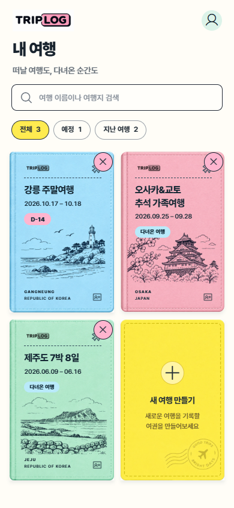
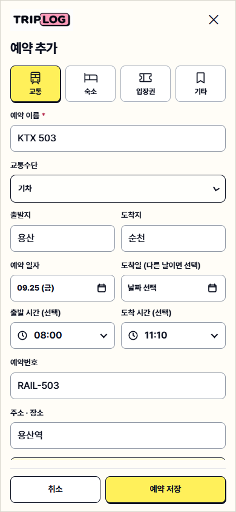
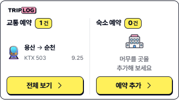
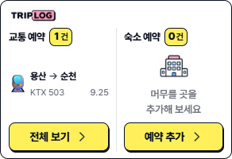

# 여행 목록 제거와 교통 예약 확장 — 2026-10-05

## 구현

- 내 여행 여권 카드 오른쪽 위에 독립된 제거 버튼을 추가했습니다. 여행을 여는 버튼과 중첩하지 않았고, 44px 터치 영역·이름이 포함된 확인·취소 후 포커스 복귀·진행 중 중복 클릭 방지를 적용했습니다. 기존 복구 기록, 공유 여행의 소유자/멤버별 처리, 마지막 여행 보호 규칙을 사용합니다.
- 교통 예약에 교통수단, 출발지, 도착지, 출발 시간, 도착 시간, 다른 날짜에 도착하는 경우의 도착일을 추가했습니다. 교통수단은 기차·항공·버스·지하철·배/페리·차량/렌터카·택시·기타입니다.
- 예약을 일정에 추가할 때 이 정보를 함께 저장합니다. 연결된 일정은 구간/시간의 기준이며, 예약 수정도 해당 일정에 반영됩니다. 일정 수정·빠른 시간 조정 후 예약 값을 동일하게 저장하고 예약 목록의 중복을 방지합니다. 기존 이동 구간, 이동 경비, 예약번호, 메모와 첨부를 보존합니다.
- 항공권 지출의 기존 귀국 출발일/시각은 새 교통 예약의 도착일/시각과 구분합니다. 기존 왕복 항공권을 일정으로 연결할 때 귀국 시각을 가는 편 도착 시각으로 복사하지 않습니다.
- 개요의 교통 요약은 왼쪽 교통수단 이모지, 오른쪽 출발지 → 도착지, 아래 예약명과 예약일자 한 줄입니다. 모바일 2열을 유지하고 글자 크기와 본문 최소 높이를 줄였습니다. 전체 예약은 기존 전체 보기 버튼으로 열 수 있습니다.

## 목업 생성 기록

- 방식: built-in image generation, T2I, 1회.
- 이미지 입력: 없음. 사용자 첨부 화면은 변경 요청의 맥락이며 생성 입력으로 전달하지 않았습니다.
- 기존 파일 덮어쓰기: 없음.
- 호출이 반환한 원본: `C:/Users/tbdk5/.codex/generated_images/01a0c429-1920-7d20-a95f-bb0950d8831b/exec-02aeef0e-1a60-4f92-b368-95c1a9da623a.png`.
- 저장본: [concept.png](concept.png).
- 원본/저장본 SHA256 일치: `CAF3CCFFDAC33241D7E3253F5F4343C129EF3469A3BCE450AD6FC1B660058336`.
- 최종 프롬프트:

> Create a TripLOG mobile UI concept showing two component studies at a 390px viewport width. The travel library uses a two-column grid of illustrated passport-style trip covers, with a separate small remove button on each cover. The reservation overview uses two compact equal-width columns for transport and accommodation, with white backgrounds, dark outlines, pink labels and yellow action buttons from the existing TripLOG interface. In the transport summary, place a train emoji on the left. To its right, show the departure “용산” then an arrow then the destination “순천” on one line. Directly underneath, show the smaller reservation name “KTX 503” on the left and the reservation date “10.10” on the right of the same line. Keep the text compact and readable, with less empty space. Include the labels “교통”, “숙소”, and “전체보기”.

목업 중 카드의 제거 동작과 교통 요약의 좌우·상하 정보 배치를 구현했습니다. 기존 여권 삽화, 전체 화면 구성과 숙소 목록은 프로젝트의 기존 자산·구조를 사용합니다.

## 검증

- 전체 `npm test` 통과. 예약 정규화, 새 필드의 동기화 모델 왕복, 일정 유래 교통 예약의 분류, 중복 제거, 잘못된 도착 시간/날짜, 자정을 넘기는 일정의 캘린더 내보내기, 기존 항공권 귀국 시간 보존을 검사했습니다.
- 전체 `npm run test:browser` 통과. 새 `transport-reservations-browser-regression.js`가 저장 실패 시 입력 유지, 새로고침, 예약→일정→예약 수정, 다음 날 도착, 오래된 편집 방지, 여행 제거 취소·검색 유지·복구 가능한 스냅샷·공유 보관 실패·현재 여행 전환·마지막 여행 보호를 확인합니다.
- 새 교통 요약을 320/390/599/600/850/1440px에서 검사했습니다. 이모지가 경로 왼쪽에 있고 예약명과 날짜가 같은 줄에 있으며 가로 넘침이 없습니다. 기존 요약의 긴 텍스트·여러 예약·빈 상태 검사도 통과했습니다.
- 실화면에서 글꼴, 줄 정렬, 카드 그림 로딩, 입력 폼과 일정 연결 결과를 확인했습니다. 라이브러리 캡처는 원본 이미지 디코딩까지 기다려 로딩 중의 빈 그림이 증거에 섞이지 않게 했습니다.
- 운영 사용자 데이터는 수정하지 않았습니다. UI 검사는 외부 요청을 차단한 합성 데이터로 수행했습니다. 실제 iOS/Android 기기 및 Safari는 별도로 검사하지 않았습니다.

### 실제 화면

| 여행 목록 | 교통 예약 폼 |
| --- | --- |
|  |  |

배포 결과는 [운영 파일 검증 기록](production-verification.json)에 별도로 기록합니다.
